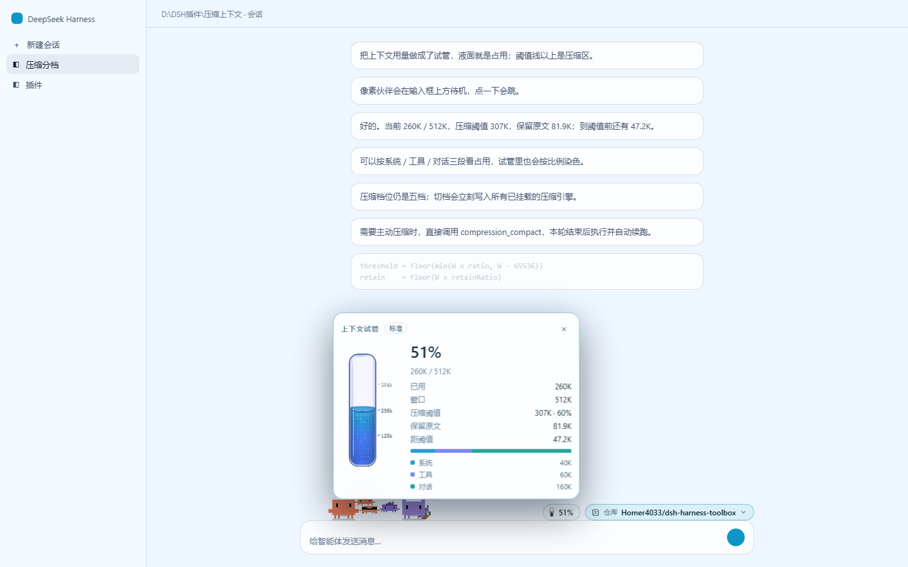
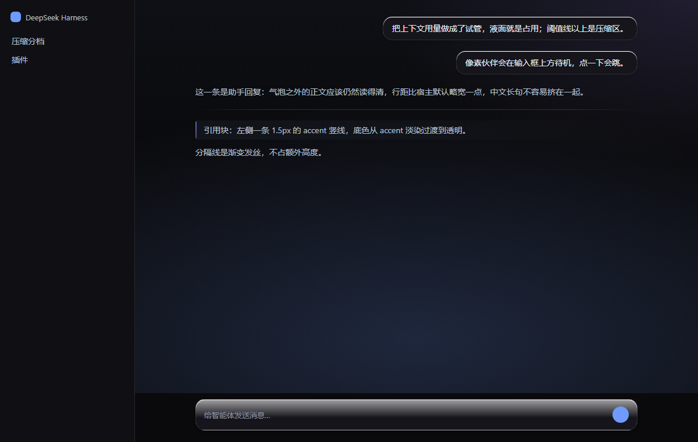
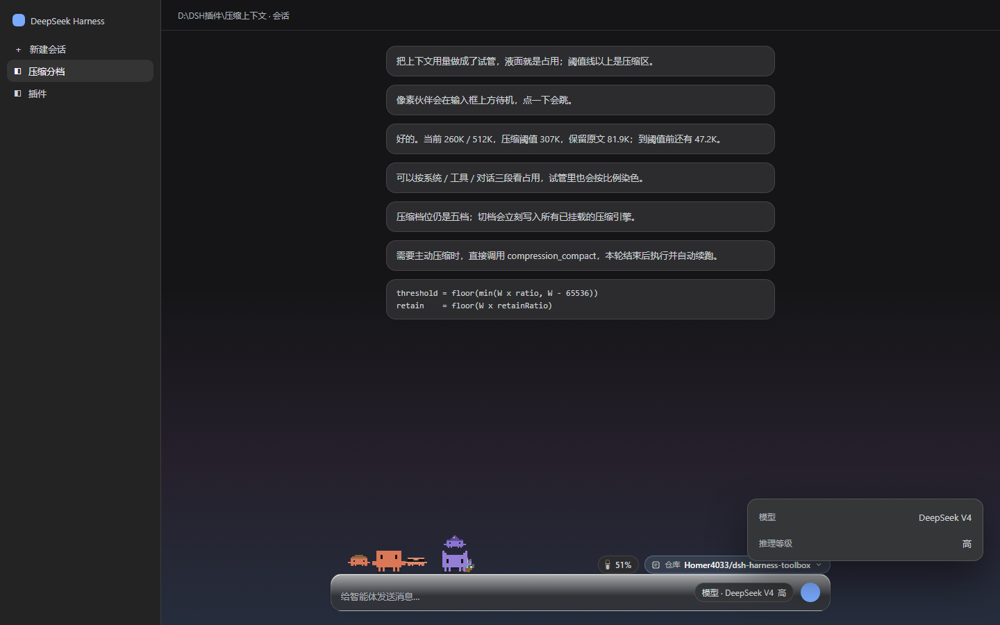
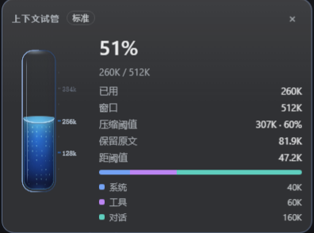

<div align="center">


# 压缩分档与综合工作台 · dsh-harness-toolbox

**为 DeepSeek Harness 打造的五档上下文压缩与综合工作台**

五档压缩 · 会流动的上下文试管 · 本地模型与六套托管组件 · 两套跟随宿主深浅的配色 · 全局与工作区规则 · 会话仓库发布

[**更新日志 (CHANGELOG)**](./CHANGELOG.md) · [**问题反馈 (Issues)**](https://github.com/Homer4033/dsh-harness-toolbox/issues) · [**npm 包**](https://www.npmjs.com/package/dsh-harness-toolbox) · [**插件详情**](./docs/DETAIL.zh.md)

<p>
  <a href="https://www.npmjs.com/package/dsh-harness-toolbox"></a>
  
  
  <a href="https://github.com/Homer4033/dsh-harness-toolbox/actions"></a>
  
  <a href="./LICENSE"></a>
  <a href="./NOTICE"></a>
</p>


<sub>以上画面由离线渲染舞台直接运行本仓库前端源码截图，示例会话、仓库与数字均为虚构。</sub>

</div>

> **非官方项目与商标免责声明 (Non-Affiliation Disclaimer)**
>
> 本项目是独立的开源 DSH 插件，与 DeepSeek 无隶属、赞助或官方背书关系。
> 界面概念与三份脚本移植自 [Obsidian Prism](https://github.com/RMvdesi/obsidian-prism)（GPL-3.0-only）；原作者与该项目不因此为本项目背书。

---

## 目录

- [亮点](#亮点)
- [界面预览](#界面预览)
- [快速安装指南](#快速安装指南)
- [使用](#使用)
- [五档参数](#五档参数)
- [组件管理](#组件管理)
- [技术细节](#技术细节)
- [兼容性与限制](#兼容性与限制)
- [开源协议、二次开发与致谢](#开源协议二次开发与致谢)
- [开发](#开发)

---

## 亮点

- **五档压缩，点一下写进去**：`gentle` / `light` / `standard` / `aggressive` / `max` 五档，选中即同步进所有已挂载的预设压缩引擎并留档，不重启；每档都保留官方自动压力压缩。
- **看见的上下文与摸得到的推理档**：输入框上方的小试管实时显示占用——液面就是 `已用 / 窗口`，刻度线是对应的压缩阈值；点开能读到已用、窗口、压缩阈值、保留原文、距阈值，以及系统 / 工具 / 对话三段构成。官方模型菜单里则多一条推理滑块，直接改当前会话的推理等级。
- **本地模型单独一个文件夹**：「模型和组件」页能一键下载 **FLUX.2 [klein] 4B** 的蒸馏 4 步版本（`black-forest-labs/FLUX.2-klein-4B`，Apache-2.0、免登录、18 个 diffusers 文件、共约 15.98 GB），装在下载根下单独的 `models/` 目录里，和六套组件分开放；逐文件断点续传，只有完整文件才落盘。
- **两套配色，换的是整个界面，跟着 DSH 走**：深空黑曜偏靛蓝，白昼冷晶偏冰青；每套都带亮、暗两份 token，DSH 切深色就用深色那份、切浅色就用浅色那份，皮肤不会把宿主的外观偏好掰到另一边。另有默认的「跟随宿主」——不覆盖任何颜色，照官方主题走。选中一套时，侧栏、消息气泡、输入框、菜单、卡片与代码块一起换，不只是插件自己的面板。
- **主题美术也一起搬**：光换 token 宿主表面还是平的，所以还会画一层美术——对话区底部一条静态底光、16px 圆角的烟熏用户气泡、引用块左侧 accent 竖条、84% 宽的发丝分隔线、6px 细滚动条、输入卡顶部光泽；「跟随宿主」下用 DSH 自己的颜色画（不是关掉这层），外观页还能单独关掉美术。
- **底光是一条不动的渐变**：2.4.6 起对话区底部只有一条 `linear-gradient`（accent 16% → 冰蓝 9% @26% → 透明 @54%），2.5.0 起底座上那截由同一层的 `::before` 伪元素按实测高度补上，接缝不再有台阶；没有 canvas、没有帧、没有动画。2.4.0–2.4.5 那套 canvas 地平线渲染器已删除。
- **规则只有一份**：全局规则写 `<DSH home>/AGENTS.md`，工作区规则写各工作区根目录的 `AGENTS.md`（插件只占其中开头一个受管块，文件其余部分是工作区自己的）；插件不复制、不缓存，智能体没有改写它们的工具，只能由人在面板里保存。
- **六套组件一个根目录**：GitHub CLI、git、ffmpeg / ffprobe、Python 都能检测系统 PATH 副本或下载托管版，断点续传、自检后原子替换、失败回滚；ComfyUI 与官方 ComfyUI MCP 是两棵源码树（GitHub 仓库归档，不做 PATH 检测），同样下载、自检、原子替换；整个根目录可在面板里迁移。
- **发布只有一个入口**：`github_push` 依次做网络体检 → 密钥扫描 → 60 秒超时推送 → 失败分类；输入框上方的「仓库」胶囊决定当前会话推到哪里，胶囊在空会话里也在。
- **轻、守规矩**：面板只用官方主题 token、不引入 Host 的 Client 包；托管副本只插本进程 PATH，不写系统环境变量；移植的那份 UMD 模块走同源脚本路由，按需加载。

---

## 界面预览

### 1. 两套配色与外观页

外观页把配色、动效与光学外观放在一张卡里，选完立刻生效（乐观写入，失败回滚）。配色走宿主官方的主题服务（`overrideTokens`）：面板页、输入框上方那一行、portal 到 body 的菜单照旧各带一份皮肤，同时把整套 token 叠加到宿主主题上，于是侧栏、气泡、输入框、菜单与代码块一起换色。两套配色都同时提供亮色与暗色两份值，**深色 / 浅色由 DSH 自己决定**——切一下官方主题，皮肤跟着切，不用回面板再点一次。

<p align="center">
  
</p>

<p align="center">
  
</p>

换掉的不是某个面板，而是整块画面：侧栏选中态、消息气泡、输入框、发送键、试管图例都跟着配色走。

| 主题预设 | 配置键值 | 深色画布 | 浅色画布 | 说明 |
| :--- | :--- | :--- | :--- | :--- |
| **跟随宿主** | `appearance.palette: "host"` | 宿主 token | 宿主 token | 默认；不覆盖颜色，深浅随官方主题 |
| **深空黑曜** | `appearance.palette: "obsidian"` | `#0A0A0C` | `#E6EDF6` | 靛蓝 accent，近黑石板深色 / 冷灰蓝浅色 |
| **白昼冷晶** | `appearance.palette: "crystal"` | `#070B12` | `#EEF6FF` | 冰青 accent，冷蓝黑深色 / 冰白浅色 |

2.0.0 的暖炭玄岩与暖白画册已下线：旧配置里的 `warm` / `alabaster` 会按冷暖性格迁移到深空黑曜 / 白昼冷晶，升级后不会白丢皮肤、也不会回落成「跟随宿主」。

### 2. 主题美术：底光、烟熏气泡与输入卡

只换 token 的话，宿主表面还是平的。插件还会把上游 `style.css` 里能用**语义锚点**表达的那层美术画上去：对话区底部一条静态线性渐变（下一节细说）、用户气泡换成 16px 圆角的烟熏表面（顶部 2.2% 光泽 + 1px 描边 + 内侧高光 + 深落影）、引用块左侧 1.5px 的 accent→冷紫竖条、`hr` 收成 84% 宽的发丝渐变、滚动条收成 6px 细条、输入卡顶部一层 3% 光泽。对话正文的行距放宽到 1.72，中西文长句不再挤在一起。

<p align="center">
  
</p>

这层美术挂在 `<body>` 的属性上（`data-ct-palette` / `data-ct-art` / `data-ct-motion`），由外观页「光学外观」开关控制；配色只决定用哪套 token 来画——选「跟随宿主」时美术就用 DSH 自己的颜色画，不再整层消失。所有选择器只用 DSH 自己的语义属性（`[data-conversation-region]`、`[data-message-bubble]`、`[data-composer-card]`、`[data-conversation-scroll]`），不碰哈希类名，命中不到就自然不生效。上游的背景极光本身是 canvas 着色器，2.3.0 只重画了静态部分，2.4.6 起连背景本身也只剩一条线性渐变（见下一节）。

### 3. 静态渐变：一层不动的底光

2.4.6 起对话区底部只有**一条线性渐变**：从底边的 accent 16% 淡染升到 26% 处的冰蓝 9%、54% 处收敛为全透明，贴在 `[data-conversation-region='chat']` 上，没有 canvas、没有帧、没有动画。此前 2.4.0–2.4.5 用的是移植来的地平线渲染器（逐像素 halftone 点阵、约 30fps），用户实测嫌它"像一条动的带子"，2.4.6 把渲染器整个撤掉（`vendor/obsidian-prism/horizon-glow.js` 已删除），只留这层静态底光。

<p align="center">
  
</p>

它跟静态美术共用一个开关：跟随宿主时用宿主的颜色画，关掉「光学外观」就整层移除。**同一层还顺手把宿主那行浅色统计字（`[data-composer-stat]`：轮/步、tok/s、总 token、缓存命中）藏起来**，同样的读数挪进试管浮窗的「本会话用量」一段——聊天区底部因此只剩输入卡本身。2.5.0 起连宿主底栏那颗 `○ 5%` 的上下文环（`ContextMeter`，一个 `aria-haspopup='dialog'` 的按钮）也一起收掉：它跟试管里的占用重复，而这件事**没有加开关**——关掉「光学外观」宿主自己就回来了。输入卡与它下面那条遮罩仍然归宿主：卡片保持不透明，正文滚到卡上方就被裁住，不会从卡里透出来。

底光本来会被输入区底座（`[data-conversation-region='composer']`）自己的遮罩截断——那条遮罩在底座顶边透明、往下 36px 变回不透明的 `bg-base`，用来挡住滚出去的正文，代价是渐变在输入卡顶边就断掉（2.4.8 的「渐变被切掉了」）。2.4.9 让底座自己重画了一遍那条渐变，可底座是 sticky + `z-index` 的层叠上下文，它重画的背景只覆盖底座那一条，和对话区里渐变的下沿接不上——这就是 2.5.0 修掉的那条「断层」。现在底座那条 `background-image` 规则整条删除，改由底座上的 `::before` 伪元素（`position: absolute; inset: 0; z-index: -1`，落在底座背景之上、输入卡之下）画**同一条渐变**：`background-size: 100% var(--ct-glow-height, 100%)` 让它和对话区那一层等高，`mask-image: linear-gradient(180deg, transparent 0px, #000 36px)` 按遮罩斜率淡出顶边；`--ct-glow-height` 由脚本按 `[data-conversation-region='chat'].clientHeight` 实测写进底座行内样式（`ResizeObserver` + 窗口 `resize` 重算，宿主换节点时重绑）。底座还是宿主的——卡片底色、遮罩、透明度一点没动，正文照样在上方被裁住。

### 4. 光学细节：上下文试管

液面高度就是 `已用 / 窗口`，试管左侧的刻度是窗口的 25% / 50% / 75%，右上方的小横线是对应档位的压缩阈值；点开浮窗还能看到官方阈值公式算出的触发点与保留原文量，以及到阈值的余量。

<p align="center">
  
</p>

试管里的液体不是一张图：`vial-core.js` 在 96×220 的 canvas 上跑一个 24 个节点的浅水波模拟，倾斜或开关浮窗时液面会荡一下。浮窗里的数字全部来自官方投影 `contextPressure` 与 `contextBreakdown`；宿主没提供投影时写「—」，不会编一个 0。

### 5. 本地模型

「模型和组件」页在六套组件下面多出一段「本地模型」：一行 **FLUX.2 [klein] 4B**，带「下载」与「重新检测」两个常显按钮，状态行、进度条与组件行同一套形状。

| 项 | 值 |
| :--- | :--- |
| 模型 | [`black-forest-labs/FLUX.2-klein-4B`](https://huggingface.co/black-forest-labs/FLUX.2-klein-4B)，蒸馏 4 步版本；[ModelScope 官方镜像](https://modelscope.cn/models/black-forest-labs/FLUX.2-klein-4B) 同路径同字节 |
| 许可 | Apache-2.0；Hugging Face 与 ModelScope 都免登录即可下载 |
| 体积 | 18 个文件，共约 **15.98 GB** |
| 位置 | `<下载根>/models/flux2-klein-4b`（与六套组件分开的独立目录，整体迁移时一起搬） |

只取 diffusers 最小集（transformer、两段文本编码器、VAE、tokenizer / scheduler / 配置）；仓库里那份重复的单文件 transformer 与三张预览图不取。下载逐文件走 HTTP Range 续传，失败留下的 `.part` 下次接着下，只有完整文件才改名落盘——所以状态只有「未安装 / 下了一部分 / 已安装」三种，进度按文件字节累计算。接口是 `GET/POST /compression-tiers/api/models`（读状态 / `{ id, action: 'download' }`），同一时间只允许一个下载任务，下载中再点返回 409。

下载端点默认**先走 ModelScope，再走镜像 `hf-mirror.com`，最后回落 `huggingface.co`**：`huggingface.co` 在国内多数网络不可达（第一版只认它，用户看到的就是 `fetch failed (gave up after 4 attempts)`）；`hf-mirror.com` 连得上，但大文件被转到 `cas-bridge.xethub.hf.co`，实测只有约 150 KB/s（15.98 GB 要一天）；ModelScope 上有一份官方 BFL 镜像仓库，18 个文件与上游**同路径同字节**（逐个核对过），同一台机器实测大文件约 33–38 MiB/s（整包 14.88 GiB 用时 456 秒）。每个文件都按这个顺序尝试，`.part` 在各端点之间共享（字节相同），所以换了 host 也还是续传、不会从零开始。要换别的镜像就设环境变量 `DSH_HF_ENDPOINT`（带 `https://`，按上游形状 `/resolve/main/` 解析，排在首选）。所有端点都失败时，面板那一行的错误会写清**每个 host 与原因**（例如 `modelscope.cn: fetch failed (ENOTFOUND); hf-mirror.com: …`），不再只有一句 `fetch failed`。

输入框上方那一行仍然只有插件在 `conversation.input.dock` 槽里加的控件：试管触发器、状态小字与当前会话的在线仓库胶囊（像素伙伴在 2.5.0 整块删除了）。行宽按输入卡的几何收窄（`--dsh-composer-card-max-width`），胶囊右缘与输入卡右缘对齐。

### 6. 推理滑块

<p align="center">
  
</p>

DSH 的模型菜单根面板有两行：模型、推理等级。插件在「推理等级」这一行下面注入一条 28px 的胶囊轨道——填充从左边长到旋钮中心，旋钮是一颗直径等于轨道高度的白色圆钮，档位点 3px。过了中间档轨道开始「通电」：紫色星云盖住已填充的那一段、一道扫光横过，还有 22 颗星尘圆点横向飘过去（越往右越多越快），满档最亮。这套几何、能量曲线与星尘都跟参考插件 [`dsh-codex-effort-slider`](https://github.com/Microqian2th/dsh-codex-effort-slider) 对齐。拖动或按 ↑ / ↓ / Home / End 时，写入走的是官方那同一个 `modelDirectories.directoryFor(sessionId).select({ provider, model, reasoningEffort })`，所以官方行上的档位名、触发器的副标题会立刻跟着变——**没有拨动后什么都不影响的装饰控件**。

挂载是 fail-open 的：宿主没有 `modelDirectories` 服务、当前模型没有 `reasoning.efforts`、只有一档、菜单没开、或者写入被拒（比如会话正被写者占用），都退回「什么都不加」，并把失败原因写在滑块下方，旋钮回到宿主确认的那一档。锚点只用语义属性（`aria-haspopup="menu"` + `aria-controls` 找菜单、`role="menuitem"` 的行配上行首标签文字认出「推理等级」、`[data-composer-card]` 判归属），不认 DSH 的哈希类名。会话目录是按需重取的——`directoryFor()` 在会话作用域就绪前会抛错，所以拿不到时按退避重试，宿主换掉目录实例时跟着重订阅；菜单前面多出别的选择器行时按标签认行、不按位置认，认不出就不加，注入后也不派发 `resize`（部分宿主用它兜底关菜单）。

### 7. 面板：液体玻璃外壳 + 五个分页

<p align="center">
  
</p>

面板在左侧栏，一次只显示一页，顺序固定为 **档位 / 规则 / 模型和组件 / 外观 / GitHub**。规则页上面一张卡编辑全局规则，下面一张卡编辑所选工作区的补充规则；没有注册工作区时那张卡照样渲染，只是写「目前无工作区」。玻璃配方、表面层级、间距与下拉规范写在 [docs/UI.md](docs/UI.md)，改控件先改规范。

### 8. 更多能力

- **规则面板**：全局规则整份写入 `<DSH home>/AGENTS.md`；工作区规则只写插件自己的受管块，保存时插到该工作区 `AGENTS.md` 的**开头**（没有文件就创建），块下面原有的正文原样保留，面板也不显示这份文件的内容。**受管块只认文件开头**：围栏必须是首个非空行加上后面一整行的结束标记，正文里顺口提到这两个标记不算（本仓库自己的 `AGENTS.md` 就提到过两次）；半个围栏（只有开头没有结尾）按空块处理，保存后不会出现第二个开头。两处写入都原子、去 BOM、CRLF→LF、保留单个结尾换行，单次上限 100,000 字符，超出直接 413 而不是截断；系统提示只带最新 2,000 字符摘要。
- **组件管理**：「模型和组件」页是一张卡片里的两段列表——组件六行 + 本地模型一行，每行是名称与钉住版本、状态、行尾「下载 / 重新检测」；路径 / 进度 / 错误横跨整行，单行不套卡片，状态没读到时整行仍在、按钮置灰。
- **GitHub 登录与体检**：`gh auth login --web` 的设备码流程，面板只显示账号与 token 的授权范围（scopes），插件不读、不存凭据；代理探测覆盖直连 / 代理 / 代理不通 / 全断四种结论。
- **会话仓库胶囊**：默认上拉，上方不足 200px 才翻成向下；↑ / ↓ / Home / End / Enter / Esc 全键盘可用。
- **下载根目录迁移**：只接受绝对路径，六套组件要么都搬要么都不动；跨卷 `EXDEV` 退化成复制后删除，搬完才写新值。

---

## 快速安装指南

要求 **Node.js ≥ 24.9**、DSH 运行时在 **`0.2.2-rc.3`（含）到 `0.3.0`（不含）** 之间（`package.json` 的 `engines` 声明，加载器据此拒绝不兼容版本）。

### 方式一：从 npm 安装（推荐）

1. DSH → **插件 → 添加插件**，输入包名 `dsh-harness-toolbox`（要锁版本就写 `dsh-harness-toolbox@2.6.2`）；
2. 安装完成后打开新会话 → 左侧栏出现 **压缩分档** 面板；
3. 面板第一页就是五个档位按钮，选一个即可。

也可以在会话里让智能体用 `plugin_manager` 安装这个包名。安装与启用都交给 DSH，**不要手改** profile 的 `package.json` / `cordis.patch.yml`。

> 国内镜像（npmmirror）同步可能滞后：插件页装不到刚发布的版本时，先 `npm view dsh-harness-toolbox version` 确认线上版本，再等镜像同步或换 registry。

### 方式二：从本地目录安装（推荐开发者）

```bash
git clone https://github.com/Homer4033/dsh-harness-toolbox.git

# 在 DSH 里：插件 → 添加插件 → 选择这个目录
```

以本地目录链接方式安装时，宿主包（`@deepseek-ai/dsh-home-paths`、`@deepseek-ai/dsh-tools`）由运行时提供，本包只声明为可选 `peerDependencies`——缺这条声明会导致 Host 半区导入失败、插件不激活。

### 升级与回退

- **1.x → 2.0.0 / 2.2.0**：`settings.json` 里多一个 `appearance` 块（缺省即 `host` / `full` / 美术层开启），规则、组件、下载目录、会话仓库绑定都不动，不需要搬文件。
- **2.4.x → 2.5.0**：像素伙伴整块删除，旧 `settings.json` 里的 `appearance.mascots` 会被直接忽略（不回写、不报错）；外观页只剩配色、动效与光学外观三组。新增「本地模型」一行，但不会自动下载任何东西。
- **2.5.x → 2.6.0**：「模型和组件」页多出 ComfyUI 与 ComfyUI MCP 两行（GitHub 仓库归档，只下载解压，不建 venv、不启动）。设置、已装组件与下载目录都不动，也不会自动下载；点了才下。
- **2.6.1 → 2.6.2**：「模型和组件」页从「一个组件一张卡」改成一张卡片里的两段列表（组件六行 + 本地模型一行），行尾两个按钮，路径 / 进度 / 错误横跨整行；数据与行为都不变，只是排版。（`hf-mirror.com` 的大文件实测只有约 150 KB/s，15.98 GB 要一天）；面板、设置与已下好的文件都不动，升级后再点「下载」会从原 `.part` 接着下。
- **许可证**：2.0.0 起整包改为 **GPL-3.0-only**（因为移植了上游 GPL 代码）；`1.10.3` 及更早的版本仍是 MIT。
- **卸载**：插件页移除即可，托管组件目录留在原处，删掉目录即彻底清理。

安装是否成功以插件页的 `application` 结果和新会话里的面板 / 工具为准，不以日志或下载进度推断。

---

## 使用

### 面板的五个分页

| 分页 | 做什么 | 唯一事实来源 |
| :--- | :--- | :--- |
| **档位** | 五个按钮，点一下写入所有已挂载的预设压缩引擎 | `src/levels.js` 的 `COMPRESSION` |
| **规则** | 全局规则整份编辑；下半张卡编辑所选工作区的补充规则（插到它 `AGENTS.md` 开头） | `<DSH home>/AGENTS.md`、`<DSH home>/storages/workspace.json` + 各工作区 `AGENTS.md` |
| **模型和组件** | 六套组件的状态、下载、重新检测与下载根目录，以及一行本地模型 | `src/components.js` 的 `COMPONENTS`、`src/models.js` 的 `MODELS` |
| **外观** | 配色、动效、光学外观 | `settings.json` 的 `appearance` |
| **GitHub** | 账号、token scope、设备码登录、网络体检 | `gh` 自己的存储（插件不读凭据） |

### 输入框上方那一行

`conversation.input.dock` 是输入框正上方的整宽槽，插件在这里注册 `compression-repo`：

- **试管触发器**：显示当前占用百分比，点开 `ContextVial` 浮窗；
- **仓库胶囊**：给当前会话绑定一个在线仓库，`github_push` 默认推到它；空会话里也渲染，菜单向上弹出；
- **状态小字**：胶囊还在读仓库列表、或保存绑定失败时，在胶囊左边写一行状态。

### 官方模型菜单里的推理滑块

输入框里的「模型」按钮点开就是官方模型菜单：根面板两行（模型 / 推理等级），下面多出插件注入的那条轨道。

- 拖动轨道、点某一档、或按 ↑ / ↓ / Home / End：写入立刻发生，官方行与触发器副标题同时更新；
- 档位名（关闭 / 低 / 高 / 最高 ……）由宿主随模型下发，插件不翻译、不写死；
- 写入中轨道变忙碌态并暂时锁住，避免连点打架；被拒（会话被写者占用等）则在轨道下方写原因，旋钮退回宿主确认的档位。

### 四个智能体工具

| 工具 | 作用 |
| :--- | :--- |
| `compression_tiers` | 读或切档位；可带按路由的 `headroomTokens` 覆盖（`provider model headroom [retain]` 行） |
| `compression_context` | 读实时占用、本档阈值与剩余空间；对话尾部的 `[context]` 行给的是同样的数字 |
| `compression_compact` | 排队一次主动压缩，本轮结束后执行并自动续跑；期间你发的消息会取消排队任务或阻止续跑 |
| `github_push` | 发布当前工作区：体检 → 密钥扫描 → 60 秒超时推送 → 失败分类；密钥命中会阻止推送，人工确认后 `force: true` 放行 |

主动压缩永远让位于真人输入：你开口，排队就作废；正在跑的压缩不中断，但结束后不再注入续跑消息。

---

## 五档参数

| 档位 | 自动触发 | 逐字保留 | 定位 |
| :--- | ---: | ---: | :--- |
| `gentle` 极轻 | 80% | 20% | 与官方默认一致，最贵最晚 |
| `light` 轻量 | 70% | 18% | 比官方早一档 |
| `standard` 标准 | 60% | 16% | **默认** |
| `aggressive` 积极 | 50% | 10% | 成本优先 |
| `max` 最大 | 40% | 6% | 最省 |

官方阈值公式逐字保留：`floor(min(W × thresholdRatio, W − O − 65,536))`，逐字保留量是 `(W − O) × retainRatio`。面板与试管按同一公式显示，`0.80` 是最贵的一档而不是中间档。

---

## 组件管理

六套托管组件装在同一个可配置根目录下。前四套是可执行程序：能识别系统 PATH 里的副本，托管副本优先，并插到本进程 PATH 最前（不写系统环境变量）。后两套是源码树，没有可执行文件，也就没有 PATH 那一段。

| 组件 | 托管源 | 位置 | PATH 目录 |
| :--- | :--- | :--- | :--- |
| GitHub CLI | `cli/cli` release，钉 `2.76.2` | `<root>/gh` | `<root>/gh/bin` |
| git | MinGit，钉 `2.56.1` | `<root>/git` | `<root>/git/cmd` |
| ffmpeg / ffprobe | gyan.dev essentials（浮动 release） | `<root>/ffmpeg` | `<root>/ffmpeg/bin` |
| Python | python-build-standalone，钉 `3.11.18+20261110` | `<root>/python` | `<root>/python`、`<root>/python/Scripts` |
| ComfyUI | `Comfy-Org/ComfyUI` 仓库归档，钉 tag `v0.46.0` | `<root>/comfyui` | 无 |
| ComfyUI MCP | `Comfy-Org/comfy-mcp` 仓库归档，钉 commit `6c43880` | `<root>/comfy-mcp` | 无 |

- **下载**：HTTP Range 续传、20 分钟超时、失败自动重试（指数退避），body 超过 60 秒没有新字节按掉线重试（半开连接不会让进度条永远停在一个数上）；解压到 `<root>/.staging/<id>` 后先自检（可执行组件跑 `--version` / `-version`，源码树找标记文件 `main.py` / `pyproject.toml`），通过才整棵目录原子替换，失败回滚并保留 `.part`。
- **源码树只负责下载**：装完是两棵可以直接查看、自行接管依赖的树，插件不建 venv、不装 torch，也不启动 ComfyUI——`<root>/comfyui/main.py`、`<root>/comfy-mcp/pyproject.toml` 就是安装完成的凭据。GitHub 的 `/archive/<ref>.zip` 会在仓库外面多包一层 `ComfyUI-0.46.0/`，这一层会被剥掉，所以安装目录就是仓库根。
- **Windows 占用**：替换经 `moveIntoPlace()`——rename 重试退避，仍失败就复制过去，不再因为杀毒扫描刚写出的二进制而报 `EPERM`。
- **下载目录**：`settings.json` 的 `toolsPath`（空 = `<DSH home>/compression-tiers`）。迁移只接受绝对路径、整体搬六套组件、任一下载进行中 409、目标已存在拒绝、跨卷自动退化为复制后删除。
- **接口**：`GET/POST /compression-tiers/api/components`（读六行状态 / `{id, action:'download'}`），`GET/POST /compression-tiers/api/tools`（读目录状态 / `{action:'migrate', path}`）。
- **边界**：gh / git / ffmpeg / Python 的托管源只有 Windows，Linux / macOS 只做 PATH 检测并显示「当前系统不可用」；ComfyUI 与 MCP 的仓库归档不分平台，两种系统都能装。

---

## 技术细节

<details>
<summary><strong>分层、试管物理、阈值、配色跟随与安全边界（点击展开）</strong></summary>

**版本 `2.6.2`** 不改宿主的压缩算法、不碰宿主平面上的 `compaction-basic` 行，只通过官方 slot、官方投影与预设隔离域工作：

- **Host / Client 两个半区**：`index.js` 注册四个工具、系统提示摘要、HTTP 路由与 reconciler（把档位同步进预设隔离域里的压缩引擎）；`client.js` 只拿 `ctx.slots` / `ctx.locale` / `ctx.effect` 与主题 token 渲染侧栏面板与输入框上方那一行。面板不 import 宿主的 Client 包，下拉、菜单、按钮全部自绘。
- **普通 `<script>` 加载移植模块**：`vial-core.js`（约 75 KB）是上游 1.0.8-beta.1 的脚本，走同源路由 `GET /compression-tiers/vendor/<name>`（白名单只有这一个文件名，`text/javascript; charset=utf-8`，`cache-control: public, max-age=3600`，URL 带 `?v=2.6.2` 防止旧缓存跨版本存活）。这样 `client.js` 不用背 UMD 内容，也不用 `eval`。2.4.6 撤掉地平线渲染器、2.5.0 删除像素伙伴装配之后，白名单从三个名字收成一个，`horizon-glow.js` 与 `dual-mascot-rig.js` 都不再随包发布。
- **试管是物理的**：`vial-core.js` 导出 `createWaterVialPhysics` 与 `mountPhysicalWaterVial`，在 96×220 的 canvas 上跑 24 节点浅水波、阻尼与表面张力；宿主负责驱动 RAF 与 `step(dt)`，`isSettled()` 为真时停止重绘。液面比例与阈值刻度由面板按官方公式算好后传给物理层——物理层不认识 token。
- **数字来自官方投影**：占用与窗口来自 `useProjection('contextPressure')`，三段构成来自 `useProjection('contextBreakdown')`（`systemTokens` / `toolsTokens` / `messageTokens`）。投影缺失时渲染「—」并禁用触发器（`title` 说明读不到），不伪造 0；试管浮窗的环境（端口、主题、`reducedMotion`）由客户端传进去，移植模块不读宿主全局。
- **换肤是两条腿**：插件自己的面板 / dock / 弹层用 `.ct-skin[data-palette='…']` 上的 token（宿主界面不受影响，主题服务缺席时也不至于没皮肤）；整个 DSH 界面则由 `ctx.theme.overrideTokens('compression-tiers', tokens)` 叠一层，宿主把它写成 `<body>` 上的内联 CSS 变量，侧栏、气泡、输入框、菜单、卡片、代码块一并跟着换。每个 token 必须是 `{ light, dark }` 成对值（服务故意拒绝裸字符串），两套模式都齐备——这正是「皮肤跟随 DSH 深浅」的实现方式：宿主自己挑用哪一半。
- **配色只覆盖自己的根**：`.ct-skin[data-palette='…']` 定义在面板页、dock 行与 portal 出去的菜单上，这些值不会渗到宿主界面；`host` 是空集，保持官方主题不变。两个配色的本地 token 也按宿主模式分两份：默认块是浅色宿主读到的值，`body[data-ds-dark-theme]`（官方主题 presenter 自己写的属性）下换成深色那份；这里不写 `color-scheme`，`html` 上已经有宿主设的那一份。
- **皮肤不掰用户的主题**：2.0.0 选深色配色会把宿主外观偏好一并切到深色，2.2.0 去掉了这次写入——配色自带亮暗两份值，用户切官方主题时皮肤跟着走。
- **美术层只认语义属性**：`applyOptics()` 在 `<body>` 上写 `data-ct-palette` / `data-ct-art`，样式表里每条美术规则都以 `body[data-ct-art='on']` 开头，选择器只用 DSH 自己的 `[data-conversation-region]` / `[data-conversation-scroll]` / `[data-message-bubble]` / `[data-composer-card]` 与对话区的 `hr` / `blockquote`；命中不到就不生效，不碰哈希类名。
- **推理滑块挂官方那一行，写入走官方那条路**：客户端 `ctx.inject(['modelDirectories'])` 拿到每个会话的模型目录，读 `store.getSnapshot()` 的 `groups[].models[].reasoning.efforts`，写 `directory.select({ provider, model, reasoningEffort })`，并用 `store.subscribe()` 跟官方行同步。DOM 桥只用语义属性——`button[aria-haspopup="menu"][aria-expanded="true"]` + `aria-controls` 找菜单、`button[role="menuitem"]` 配上行首标签认出推理等级行（根面板恰好两行时按官方布局兜底，更多行且无标签命中就不注入）、`[data-composer-card]` 判归属——认不出就不注入；目录按需重取（会话作用域就绪前 `directoryFor()` 会抛错，按 60 / 240 / 540 / 960 / 1500 / 3000ms 退避重试），实例被换掉时退旧订阅、重新订阅。几何与参考插件一致：28px 胶囊轨道、白色圆钮、3px 档位点，填充停在旋钮圆心，满档时轨道泛紫光。写失败会在轨道下方写原因并把旋钮退回宿主确认的档位，不谎报成功。
- **状态只落一个文件**：`<DSH home>/compression-tiers/settings.json`，所有写入是「临时文件 + rename」；手改坏的 JSON 回落到默认值，不让插件崩。`appearance` 在读写两侧都归一化，未知配色 / 动效值直接回落默认而不是报错。
- **规则写入**：去 BOM、CRLF 归一 LF、保留单个结尾换行，单次上限 100,000 字符（超出 413 且不落盘）；系统提示只带最新 2,000 字符摘要，从不整份注入，也不把摘要写回文件。
- **托管安装**：下载 → `.staging` → 自检 → `moveIntoPlace()` 原子替换 → 失败回滚；已下载完的归档在下一次重试时复用，不再白下第二遍——但**只有完整下载才落成归档**（body 比 `content-length` 短算可重试的断点续传），归档解压不出二进制或暂存自检失败时会先删掉它，下一次重新下载而不是反复解压同一个坏文件。备份目录的清理失败不会回滚已经自检通过的安装。
- **发布边界**：会话绑定的仓库只改 `github_push` 的推送目标，不克隆、不切分支、不动会话工作区；绑定归一化为 `owner/name`，非法值丢弃，最多 200 条。
- **测试**：`npm test` 257 条 `node:test` 用例，覆盖档位与公式、路由、引擎同步、全局规则与工作区受管块（创建 / 替换 / 保留正文 / 只读受管块 / 整行围栏标记 400）、`gh` / 组件 / 下载位置（含短读重试、停住 60 秒的掉线重试、PowerShell 兜底、复制失败回滚后半程可重试）、源码树组件（仓库归档的 `any` 资产、剥掉 GitHub 的 `ComfyUI-0.46.0/` 外层目录、按标记文件判定安装、不参与 PATH、六行统一形状）、组件与模型的列表页（一张卡片、两段列表、七行、行尾两个按钮、不再有 `ct-component`）、本地模型（钉住的文件清单与总字节数、端点顺序与回落、`DSH_HF_ENDPOINT` 覆盖、三态、`.part` 续传、下载中 409、未知 id 404）、发布流程、移植模块的 UMD 装载与署名（白名单只剩 `vial-core.js`）、配色的成对值 / 旧配色迁移 / 皮肤只叠一层、推理滑块的档位映射 / 轨道几何 / 语义锚点查找（含标签认行与多行时的不注入）/ 目录退避与重建 / 写入与回滚、三档动效 / `host` 撤下与渲染器降级、试管禁用态、设置快照推送、底光 `::before` 与 `--ct-glow-height`、宿主上下文环隐藏，manifest 与 locale；CI 在 Windows 与 Linux 两侧跑同一套。

</details>

---

## 兼容性与限制

- **窗口大小**：五档按 ≥ 256k tokens 的窗口设计；128k 窗口下各档只剩「保留量」不同，≤ 64k 的窗口会被官方 65,536 的输出余量卡住——用 `compression_tiers` 的 `routeLines` 给该路由写更小的 `headroomTokens`。
- **宿主平面**：只更新预设隔离域里的引擎；如果别的插件也管同一批引擎，两边会互相覆盖，只留一个。
- **网络**：GitHub 与 npm 相关操作要能访问 `github.com`；代理死掉或 DNS 被污染时用「网络体检」定位。ffmpeg 需要能访问 `www.gyan.dev`，git / Python / ComfyUI / ComfyUI MCP 需要能访问 `github.com`（后两者的仓库归档走 `github.com/.../archive/...`，国内网络下这个地址偏慢，13.7 MB 的 ComfyUI 归档可能要几分钟），本地模型先试 `modelscope.cn`、再试 `hf-mirror.com`、最后 `huggingface.co`。
- **托管副本会盖过系统版本**：装了托管 git / Python 后，本进程内的 `git` / `python` 优先用托管副本；删掉 `<root>/git`、`<root>/python` 并重启即回退。
- **ComfyUI / MCP 只装代码**：两行下载的是仓库归档，装完是 `<root>/comfyui` 与 `<root>/comfy-mcp` 两棵源码树，插件不建 venv、不装依赖（torch 等要自己装）、也不启动服务；「已安装」只代表归档解开且标记文件在（`main.py` / `pyproject.toml`），删掉目录即清掉。MCP 服务器钉的是一个 commit 而不是版本号，面板上的版本位直接写 `commit 6c43880`。
- **推理滑块不是每条会话都有**：它只在当前模型真的暴露 `reasoning.efforts`（≥2 档）时出现；子智能体会话、没有 `modelDirectories` 服务的宿主、或模型没有推理档位时不渲染任何东西。写入失败（例如会话正被写者占用）会在滑块下方写原因并回滚，不会留下一个假的选中态。
- **本地模型要自己下**：FLUX.2 [klein] 4B 约 15.98 GB，插件只负责下载与文件大小校验，不内置权重、也不校验哈希；面板里点了才下，删掉 `<root>/models/<id>` 即彻底清掉。下载默认从 ModelScope 拉（同一台机器实测 `hf-mirror.com` 的大文件只有约 150 KB/s，所以排在它后面），再回落 `hf-mirror.com` 与 `huggingface.co`（`DSH_HF_ENDPOINT` 可换镜像）；下载中途断网留在原地的 `.part` 下次接着下，卡住 60 秒不动也会自动重连续传。
- **美术层与配色解耦**：2.4.2 起「跟随宿主」也用宿主 token 画这层美术，不是关掉；外观页的「光学外观」开关常显可点，关掉只去掉底光 / 气泡 / 分隔线这些美术，配色 token 仍然生效。
- **渲染未验证**：README 里的画面来自离线渲染舞台（同源静态预览 + 无头 Chrome，直接运行本仓库的 `client.js`），**真实 DSH 窗口里的最终观感仍需刷新页面后确认**。推理滑块是在舞台里对着一个按官方语义属性搭的模型菜单跑通的（挂载、拖动写入、官方行跟着更新、被拒回滚都验证过）；真实 DSH 菜单里的位置与观感仍要在窗口里确认一遍。
- **仓库 UI**：没有仓库列表，也没有推送按钮。多仓库由智能体在各自会话里调用 `github_push`；胶囊只决定当前会话的目标。

---

## 开源协议、二次开发与致谢

### 1. 二次开发与分发协议 (`GPL-3.0-only` + `NOTICE`)

**dsh-harness-toolbox**（`Copyright (C) 2026 Homer and the dsh-harness-toolbox contributors`）采用 **[GNU General Public License v3.0 (`GPL-3.0-only`)](./LICENSE)** 发布，并附带 **[`NOTICE`](./NOTICE)** 与 **[`THIRD_PARTY_NOTICES.md`](./THIRD_PARTY_NOTICES.md)**。

基于本项目做修改、二次开发、移植或打包再分发时，须遵守：

1. **同源开源（Copyleft）**：任何包含或修改自本项目的衍生插件，整体须同样以 **GPL-3.0** 开放完整对应源代码。
2. **保留署名链**：衍生仓库根目录须完整保留 [`LICENSE`](./LICENSE)、[`NOTICE`](./NOTICE) 与 [`THIRD_PARTY_NOTICES.md`](./THIRD_PARTY_NOTICES.md)，并在 README 保留对原作者 `RMvdesi` 与上游仓库 `RMvdesi/obsidian-prism` 的来源链接。
3. **标注修改**：修改过的上游文件须注明修改日期与变更摘要（本项目在 vendor 文件的头部写明）；不得用未修改的「Obsidian Prism 官方原版」名义发布衍生版本。

> **许可证变更**：`1.10.3` 及更早版本以 MIT 发布；`2.0.0` 起移植了 GPL-3.0-only 的上游代码，整包改为 **GPL-3.0-only**。已经在 MIT 下发布的旧版本不受影响。

#### 下游二次开发 README 署名模板

```markdown
> Built upon [dsh-harness-toolbox](https://github.com/Homer4033/dsh-harness-toolbox) by Homer, licensed under [GPL-3.0](https://www.gnu.org/licenses/gpl-3.0.html).
> Optical vial and motion concepts ported from [Obsidian Prism](https://github.com/RMvdesi/obsidian-prism) by [@RMvdesi](https://github.com/RMvdesi) (GPL-3.0-only). Upstream component notices are preserved in `NOTICE` and `THIRD_PARTY_NOTICES.md`.
```

### 2. 上游项目与致谢 (Upstream Credits)

- **[RMvdesi/obsidian-prism](https://github.com/RMvdesi/obsidian-prism)** (`1.0.8-beta.1`) — `GPL-3.0-only`, `Copyright (C) 2026 RMvdesi`：本项目移植了 `vial-core.js`（浅水波试管），并沿用它那套光学界面语言重做了本插件的面板外壳、两套配色与动效档位；该文件头部写有出处与修改说明。2.5.0 按用户要求删除了此前移植的 `dual-mascot-rig.js`（像素伙伴装配），不再包含这份衍生代码。
- 上游本身又吸收了若干 MIT 项目（与 GPL-3.0 兼容），完整版权与许可全文保留在 [`THIRD_PARTY_NOTICES.md`](./THIRD_PARTY_NOTICES.md)，其中与本插件直接相关的有：
  - **[0DNANCY/agy-claude-style](https://github.com/0DNANCY/agy-claude-style)** — `MIT`, `Copyright (c) 2026 0DNANCY`（配色框架与像素宠物底座）。
  - **[wp3171216237/dsh-TUI](https://github.com/wp3171216237/dsh-TUI)** — `MIT`, `Copyright (c) 2026 chimney (@wp3171216237)`（Deepy 桌宠轮廓配色参考）。

### 3. 社区

问题与建议走 [Issues](https://github.com/Homer4033/dsh-harness-toolbox/issues)，改动走 Pull Request；提交前请先跑 `npm test` 与 `npm run check:secrets`。

---

## 开发

```bash
npm test               # node:test：档位、路由、状态、引擎同步、规则、GitHub、发布、组件、移植模块与 manifest
npm run check:secrets  # 仓库密钥扫描（CI 与本地共用）
```

```text
dsh-harness-toolbox/
├── package.json                  # 清单：engines.dsh、GPL-3.0-only、files/exports（含 vendor）
├── LICENSE / NOTICE              # GPL-3.0 全文 + 衍生作品署名与修改说明
├── THIRD_PARTY_NOTICES.md        # 上游及其吸收的 MIT 项目的完整声明
├── icon.svg                      # 面板图标
├── index.js                      # Host 入口：四个工具、系统提示、面板路由、reconciler、vendor 路由
├── client.js                     # 客户端：侧栏面板（五个分页）、输入框 dock、试管、自绘弹层
├── vendor/obsidian-prism/        # 移植的 UMD 模块（vial-core.js）
├── src/
│   ├── levels.js                 # 五档参数与阈值公式（唯一来源）
│   ├── presets.js                # 预设隔离域引擎同步
│   ├── context-meter.js          # 实时占用与 [context] 尾行
│   ├── manual-compact.js         # 主动压缩队列（真人输入优先）
│   ├── store.js                  # 状态读写（原子，含 appearance）
│   ├── rules.js                  # 全局规则：路径、校验、原子写入、摘要
│   ├── workspace-rules.js        # 工作区规则：注册表读取、受管块注入、原子写入
│   ├── gh.js                     # GitHub CLI：托管下载、PATH、设备码登录、仓库列表
│   ├── ffmpeg.js                 # ffmpeg / ffprobe 托管下载与 PATH
│   ├── components.js             # 托管组件：git / Python 可执行文件 + ComfyUI / MCP 源码树
│   ├── component-rows.js         # 面板六行组件的统一形状
│   ├── models.js                 # 本地模型：钉住的文件清单、状态、逐文件续传下载
│   ├── tools-path.js             # 下载根目录与整体迁移
│   ├── swap.js                   # 安装树替换（rename 重试 → 复制回退）
│   ├── publish.js                # 网络体检、push、密钥扫描、建仓
│   └── push-flow.js              # 发布流程（工具与面板共用）
├── docs/
│   ├── UI.md                     # 面板与弹层的 UI 规范（表面层级、栅格、动效、检查清单）
│   ├── DETAIL.md / DETAIL.zh.md  # 插件详情页（单图）
│   └── screenshots/              # README 与详情页用的截图
├── locale/                       # zh / en 元数据与描述
├── scripts/check-secrets.mjs     # 密钥扫描入口
├── test/                         # node:test 用例
└── .github/workflows/ci.yml      # Windows + Linux：npm test → check:secrets
```

文档冲突时优先级：**[AGENTS.md](AGENTS.md) > README.md > locale 文案**。UI 相关问题先读 [docs/UI.md](docs/UI.md)。
