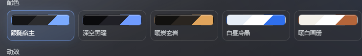
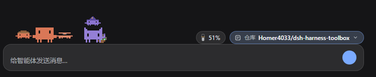

<div align="center">


# 压缩分档与工具箱 · dsh-harness-toolbox

**为 DeepSeek Harness 打造的五档上下文压缩与光学工具箱**

五档压缩 · 会流动的上下文试管 · 输入框上方的像素伙伴 · 四套深浅配色 · 全局与工作区规则 · 四套托管组件 · 会话仓库发布

[**更新日志 (CHANGELOG)**](./CHANGELOG.md) · [**问题反馈 (Issues)**](https://github.com/Homer4033/dsh-harness-toolbox/issues) · [**npm 包**](https://www.npmjs.com/package/dsh-harness-toolbox) · [**插件详情**](./docs/DETAIL.zh.md)

<p>
  <a href="https://www.npmjs.com/package/dsh-harness-toolbox"></a>
  
  
  <a href="https://github.com/Homer4033/dsh-harness-toolbox/actions"></a>
  
  <a href="./LICENSE"></a>
  <a href="./NOTICE"></a>
</p>


<sub>以上画面由离线渲染舞台直接运行本仓库前端源码截图，示例会话、仓库与数字均为虚构。</sub>

</div>

> **非官方项目与商标免责声明 (Non-Affiliation Disclaimer)**
>
> 本项目是独立的开源 DSH 插件，与 DeepSeek 无隶属、赞助或官方背书关系。
> 界面概念与两份 UMD 模块移植自 [Obsidian Prism](https://github.com/RMvdesi/obsidian-prism)（GPL-3.0-only）；原作者与该项目不因此为本项目背书。

---

## 目录

- [亮点](#亮点)
- [界面预览](#界面预览)
- [快速安装指南](#快速安装指南)
- [使用](#使用)
- [五档参数](#五档参数)
- [组件管理](#组件管理)
- [技术细节](#技术细节)
- [兼容性与限制](#兼容性与限制)
- [开源协议、二次开发与致谢](#开源协议二次开发与致谢)
- [开发](#开发)

---

## 亮点

- **五档压缩，点一下写进去**：`gentle` / `light` / `standard` / `aggressive` / `max` 五档，选中即同步进所有已挂载的预设压缩引擎并留档，不重启；每档都保留官方自动压力压缩。
- **看得见的上下文**：输入框上方的小试管实时显示占用——液面就是 `已用 / 窗口`，刻度线是对应的压缩阈值；点开能读到已用、窗口、压缩阈值、保留原文、距阈值，以及系统 / 工具 / 对话三段构成。
- **桌面上的像素伙伴**：小紫猫、Clawd 与三只迷你蟹蹲在试管左边，点一下会跳；动效可降到「克制」或直接关掉，也可以把伙伴整个收起。默认开启。
- **四套配色，换的是整个界面**：深空黑曜、暖炭玄岩两套深色，白昼冷晶、暖白画册两套浅色，另有默认的「跟随宿主」——不覆盖任何颜色，照官方主题走。选中一套时，侧栏、消息气泡、输入框、菜单、卡片与代码块一起换，不只是插件自己的面板。
- **规则只有一份**：全局规则写 `<DSH home>/AGENTS.md`，工作区规则写各工作区根目录的 `AGENTS.md`；插件不复制、不缓存，智能体没有改写它们的工具，只能由人在面板里保存。
- **四套组件一个根目录**：GitHub CLI、git、ffmpeg / ffprobe、Python 都能检测系统 PATH 副本或下载托管版，断点续传、自检后原子替换、失败回滚；整个根目录可在面板里迁移。
- **发布只有一个入口**：`github_push` 依次做网络体检 → 密钥扫描 → 60 秒超时推送 → 失败分类；输入框上方的「仓库」胶囊决定当前会话推到哪里，胶囊在空会话里也在。
- **轻、守规矩**：面板只用官方主题 token、不引入 Host 的 Client 包；托管副本只插本进程 PATH，不写系统环境变量；移植的两份 UMD 模块走同源脚本路由，按需加载。

---

## 界面预览

### 1. 四套配色与外观页

外观页把配色、动效与像素伙伴放在一张卡里，选完立刻生效（乐观写入，失败回滚）。配色走宿主官方的主题服务（`overrideTokens`）：面板页、输入框上方那一行、portal 到 body 的菜单照旧各带一份皮肤，同时把整套 token 叠加到宿主主题上，于是侧栏、气泡、输入框、菜单与代码块一起换色。选深色配色时会把宿主的外观偏好一并切到深色，「深空黑曜」不会在浅色宿主里读成白底。

<p align="center">
  
</p>

<p align="center">
  
</p>

换掉的不是某个面板，而是整块画面：侧栏选中态、消息气泡、输入框、发送键、试管图例都跟着配色走。

| 主题预设 | 配置键值 | 侧栏底色 | 主画布 | 说明 |
| :--- | :--- | :--- | :--- | :--- |
| **跟随宿主** | `appearance.palette: "host"` | 宿主 token | 宿主 token | 默认；不覆盖颜色，深浅随官方主题 |
| **深空黑曜** | `appearance.palette: "obsidian"` | `#17171B` | `#0A0A0C` | 冷调深灰，高对比代码阅读配色 |
| **暖炭玄岩** | `appearance.palette: "warm"` | `#201D19` | `#12110F` | 暖炭褐底色，低蓝光夜间配色 |
| **白昼冷晶** | `appearance.palette: "crystal"` | `#F7FAFD` | `#E6EDF6` | 冷调浅灰蓝，高明度浅色配色 |
| **暖白画册** | `appearance.palette: "alabaster"` | `#FFFDF8` | `#F4F1EA` | 暖白纸色，柔和对比度浅色配色 |

两套浅色把 `color-scheme: light` 一起设上，原生滚动条、输入框与 `Select` 弹层才不会沿用深色。

### 2. 光学细节：上下文试管

液面高度就是 `已用 / 窗口`，试管左侧的刻度是窗口的 25% / 50% / 75%，右上方的小横线是对应档位的压缩阈值；点开浮窗还能看到官方阈值公式算出的触发点与保留原文量，以及到阈值的余量。

<p align="center">
  
</p>

试管里的液体不是一张图：`vial-core.js` 在 96×220 的 canvas 上跑一个 24 个节点的浅水波模拟，倾斜或开关浮窗时液面会荡一下。浮窗里的数字全部来自官方投影 `contextPressure` 与 `contextBreakdown`；宿主没提供投影时写「—」，不会编一个 0。

### 3. 像素伙伴

<p align="center">
  
</p>

伙伴是 canvas 逐帧绘制的像素画，右侧那一行是插件在 `conversation.input.dock` 槽里加的控件：试管触发器与当前会话的在线仓库胶囊，读取中或保存失败时中间还会出现一行状态小字。行宽按输入卡的几何收窄（`--dsh-composer-card-max-width`），胶囊右缘与输入卡右缘对齐；面板或窗口窄于 620px 时伙伴自动让位，只留控件。

### 4. 面板：液体玻璃外壳 + 六个分页

<p align="center">
  
</p>

面板在左侧栏，一次只显示一页，顺序固定为 **档位 / 规则 / 工作区 / 组件 / 外观 / GitHub**；没有注册工作区时工作区页照样打开，只是写「目前无工作区」。玻璃配方、表面层级、间距与下拉规范写在 [docs/UI.md](docs/UI.md)，改控件先改规范。

### 5. 更多能力

- **规则面板**：全局与工作区两个编辑器，保存即原子写入（去 BOM、CRLF→LF、单个结尾换行），单次上限 100,000 字符，超出直接 413 而不是截断；系统提示只带最新 2,000 字符摘要。
- **组件管理**：四行统一形状——名称与版本 → 状态行 → 进度 → 路径或错误 → 同一行「下载 / 重新检测」，状态没读到时整行仍在、按钮置灰。
- **GitHub 登录与体检**：`gh auth login --web` 的设备码流程，面板只显示账号与 token 的授权范围（scopes），插件不读、不存凭据；代理探测覆盖直连 / 代理 / 代理不通 / 全断四种结论。
- **会话仓库胶囊**：默认上拉，上方不足 200px 才翻成向下；↑ / ↓ / Home / End / Enter / Esc 全键盘可用。
- **下载根目录迁移**：只接受绝对路径，四套组件要么都搬要么都不动；跨卷 `EXDEV` 退化成复制后删除，搬完才写新值。

---

## 快速安装指南

要求 **Node.js ≥ 24.9**、DSH 运行时在 **`0.2.2-rc.3`（含）到 `0.3.0`（不含）** 之间（`package.json` 的 `engines` 声明，加载器据此拒绝不兼容版本）。

### 方式一：从 npm 安装（推荐）

1. DSH → **插件 → 添加插件**，输入包名 `dsh-harness-toolbox`（要锁版本就写 `dsh-harness-toolbox@2.0.0`）；
2. 安装完成后打开新会话 → 左侧栏出现 **压缩分档** 面板；
3. 面板第一页就是五个档位按钮，选一个即可。

也可以在会话里让智能体用 `plugin_manager` 安装这个包名。安装与启用都交给 DSH，**不要手改** profile 的 `package.json` / `cordis.patch.yml`。

> 国内镜像（npmmirror）同步可能滞后：插件页装不到刚发布的版本时，先 `npm view dsh-harness-toolbox version` 确认线上版本，再等镜像同步或换 registry。

### 方式二：从本地目录安装（推荐开发者）

```bash
git clone https://github.com/Homer4033/dsh-harness-toolbox.git

# 在 DSH 里：插件 → 添加插件 → 选择这个目录
```

以本地目录链接方式安装时，宿主包（`@deepseek-ai/dsh-home-paths`、`@deepseek-ai/dsh-tools`）由运行时提供，本包只声明为可选 `peerDependencies`——缺这条声明会导致 Host 半区导入失败、插件不激活。

### 升级与回退

- **1.x → 2.0.0**：`settings.json` 里多一个 `appearance` 块（缺省即 `host` / `full` / 伙伴开启），规则、组件、下载目录、会话仓库绑定都不动，不需要搬文件。
- **许可证**：2.0.0 起整包改为 **GPL-3.0-only**（因为移植了上游 GPL 代码）；`1.10.3` 及更早的版本仍是 MIT。
- **卸载**：插件页移除即可，托管组件目录留在原处，删掉目录即彻底清理。

安装是否成功以插件页的 `application` 结果和新会话里的面板 / 工具为准，不以日志或下载进度推断。

---

## 使用

### 面板的六个分页

| 分页 | 做什么 | 唯一事实来源 |
| :--- | :--- | :--- |
| **档位** | 五个按钮，点一下写入所有已挂载的预设压缩引擎 | `src/levels.js` 的 `COMPRESSION` |
| **规则** | 编辑、保存全局系统提示规则 | `<DSH home>/AGENTS.md` |
| **工作区** | 选一个已注册工作区，编辑它根目录的规则 | `<DSH home>/storages/workspace.json` + 各工作区 `AGENTS.md` |
| **组件** | 四套组件的状态、下载、重新检测与下载根目录 | `src/components.js` 的 `COMPONENTS` |
| **外观** | 配色、动效、像素伙伴开关 | `settings.json` 的 `appearance` |
| **GitHub** | 账号、token scope、设备码登录、网络体检 | `gh` 自己的存储（插件不读凭据） |

### 输入框上方那一行

`conversation.input.dock` 是输入框正上方的整宽槽，插件在这里注册 `compression-repo`：

- **试管触发器**：显示当前占用百分比，点开 `ContextVial` 浮窗；
- **仓库胶囊**：给当前会话绑定一个在线仓库，`github_push` 默认推到它；空会话里也渲染，菜单向上弹出；
- **状态小字**：胶囊还在读仓库列表、或保存绑定失败时，在胶囊左边写一行状态。

### 四个智能体工具

| 工具 | 作用 |
| :--- | :--- |
| `compression_tiers` | 读或切档位；可带按路由的 `headroomTokens` 覆盖（`provider model headroom [retain]` 行） |
| `compression_context` | 读实时占用、本档阈值与剩余空间；对话尾部的 `[context]` 行给的是同样的数字 |
| `compression_compact` | 排队一次主动压缩，本轮结束后执行并自动续跑；期间你发的消息会取消排队任务或阻止续跑 |
| `github_push` | 发布当前工作区：体检 → 密钥扫描 → 60 秒超时推送 → 失败分类；密钥命中会阻止推送，人工确认后 `force: true` 放行 |

主动压缩永远让位于真人输入：你开口，排队就作废；正在跑的压缩不中断，但结束后不再注入续跑消息。

---

## 五档参数

| 档位 | 自动触发 | 逐字保留 | 定位 |
| :--- | ---: | ---: | :--- |
| `gentle` 极轻 | 80% | 20% | 与官方默认一致，最贵最晚 |
| `light` 轻量 | 70% | 18% | 比官方早一档 |
| `standard` 标准 | 60% | 16% | **默认** |
| `aggressive` 积极 | 50% | 10% | 成本优先 |
| `max` 最大 | 40% | 6% | 最省 |

官方阈值公式逐字保留：`floor(min(W × thresholdRatio, W − O − 65,536))`，逐字保留量是 `(W − O) × retainRatio`。面板与试管按同一公式显示，`0.80` 是最贵的一档而不是中间档。

---

## 组件管理

四套托管组件装在同一个可配置根目录下，都能识别系统 PATH 里的副本；托管副本优先，并插到本进程 PATH 最前（不写系统环境变量）。

| 组件 | 托管源 | 位置 | PATH 目录 |
| :--- | :--- | :--- | :--- |
| GitHub CLI | `cli/cli` release，钉 `2.76.2` | `<root>/gh` | `<root>/gh/bin` |
| git | MinGit，钉 `2.56.1` | `<root>/git` | `<root>/git/cmd` |
| ffmpeg / ffprobe | gyan.dev essentials（浮动 release） | `<root>/ffmpeg` | `<root>/ffmpeg/bin` |
| Python | python-build-standalone，钉 `3.11.18+20261110` | `<root>/python` | `<root>/python`、`<root>/python/Scripts` |

- **下载**：HTTP Range 续传、20 分钟超时、失败自动重试（指数退避）；解压到 `<root>/.staging/<id>` 后先跑 `--version` / `-version` 自检，通过才整棵目录原子替换，失败回滚并保留 `.part`。
- **Windows 占用**：替换经 `moveIntoPlace()`——rename 重试退避，仍失败就复制过去，不再因为杀毒扫描刚写出的二进制而报 `EPERM`。
- **下载目录**：`settings.json` 的 `toolsPath`（空 = `<DSH home>/compression-tiers`）。迁移只接受绝对路径、整体搬四套组件、任一下载进行中 409、目标已存在拒绝、跨卷自动退化为复制后删除。
- **接口**：`GET/POST /compression-tiers/api/components`（读四行状态 / `{id, action:'download'}`），`GET/POST /compression-tiers/api/tools`（读目录状态 / `{action:'migrate', path}`）。
- **边界**：托管源只有 Windows；Linux / macOS 只做 PATH 检测并显示「当前系统不可用」。

---

## 技术细节

<details>
<summary><strong>分层、试管物理、阈值、配色隔离与安全边界（点击展开）</strong></summary>

**版本 `2.0.0`** 不改宿主的压缩算法、不碰宿主平面上的 `compaction-basic` 行，只通过官方 slot、官方投影与预设隔离域工作：

- **Host / Client 两个半区**：`index.js` 注册四个工具、系统提示摘要、HTTP 路由与 reconciler（把档位同步进预设隔离域里的压缩引擎）；`client.js` 只拿 `ctx.slots` / `ctx.locale` / `ctx.effect` 与主题 token 渲染侧栏面板与输入框上方那一行。面板不 import 宿主的 Client 包，下拉、菜单、按钮全部自绘。
- **普通 `<script>` 加载移植模块**：`vial-core.js`（约 75 KB）与 `dual-mascot-rig.js`（约 231 KB）是上游 1.0.8-beta.1 的 UMD 模块，走同源路由 `GET /compression-tiers/vendor/<name>`（只服务这两个文件名，`text/javascript; charset=utf-8`，`cache-control: public, max-age=3600`，URL 带 `?v=2.0.0` 防止旧缓存跨版本存活）。这样 `client.js` 不用背 300 KB，也不用 `eval`。
- **试管是物理的**：`vial-core.js` 导出 `createWaterVialPhysics` 与 `mountPhysicalWaterVial`，在 96×220 的 canvas 上跑 24 节点浅水波、阻尼与表面张力；宿主负责驱动 RAF 与 `step(dt)`，`isSettled()` 为真时停止重绘。液面比例与阈值刻度由面板按官方公式算好后传给物理层——物理层不认识 token。
- **数字来自官方投影**：占用与窗口来自 `useProjection('contextPressure')`，三段构成来自 `useProjection('contextBreakdown')`（`systemTokens` / `toolsTokens` / `messageTokens`）。投影缺失时渲染「—」，不伪造 0；试管浮窗的环境（端口、主题、`reducedMotion`）由客户端传进去，移植模块不读宿主全局。
- **换肤是两条腿**：插件自己的面板 / dock / 弹层用 `.ct-skin[data-palette='…']` 上的整份 token（宿主界面不受影响，主题服务缺席时也不至于没皮肤）；整个 DSH 界面则由 `ctx.theme.overrideTokens('compression-tiers', tokens)` 叠一层，宿主把它写成 `<body>` 上的内联 CSS 变量，侧栏、气泡、输入框、菜单、卡片、代码块一并跟着换。每个 token 必须是 `{ light, dark }` 成对值（服务故意拒绝裸字符串），两套模式都定义好，用户事后在设置里手切亮暗也不会读不清。
- **配色是整份 token 覆盖，但只覆盖自己的根**：`.ct-skin[data-palette='…']` 定义在面板页、dock 行与 portal 出去的菜单上，这四套值不会渗到宿主界面；`host` 是空集，保持官方主题不变。浅色两套同时设 `color-scheme: light`。
- **状态只落一个文件**：`<DSH home>/compression-tiers/settings.json`，所有写入是「临时文件 + rename」；手改坏的 JSON 回落到默认值，不让插件崩。`appearance` 在读写两侧都归一化，未知配色 / 动效值直接回落默认而不是报错。
- **规则写入**：去 BOM、CRLF 归一 LF、保留单个结尾换行，单次上限 100,000 字符（超出 413 且不落盘）；系统提示只带最新 2,000 字符摘要，从不整份注入，也不把摘要写回文件。
- **托管安装**：下载 → `.staging` → 自检 → `moveIntoPlace()` 原子替换 → 失败回滚；已下载完的归档在下一次重试时复用，不再白下第二遍。PATH 前插只影响本进程，且去重。
- **发布边界**：会话绑定的仓库只改 `github_push` 的推送目标，不克隆、不切分支、不动会话工作区；绑定归一化为 `owner/name`，非法值丢弃，最多 200 条。
- **测试**：`npm test` 205 条 `node:test` 用例，覆盖档位与公式、路由、引擎同步、规则与工作区规则、`gh` / 组件 / 下载位置、发布流程、移植模块的 UMD 装载与署名、manifest 与 locale；CI 在 Windows 与 Linux 两侧跑同一套。

</details>

---

## 兼容性与限制

- **窗口大小**：五档按 ≥ 256k tokens 的窗口设计；128k 窗口下各档只剩「保留量」不同，≤ 64k 的窗口会被官方 65,536 的输出余量卡住——用 `compression_tiers` 的 `routeLines` 给该路由写更小的 `headroomTokens`。
- **宿主平面**：只更新预设隔离域里的引擎；如果别的插件也管同一批引擎，两边会互相覆盖，只留一个。
- **网络**：GitHub 与 npm 相关操作要能访问 `github.com`；代理死掉或 DNS 被污染时用「网络体检」定位。ffmpeg 需要能访问 `www.gyan.dev`，git / Python 需要能访问 `github.com`。
- **托管副本会盖过系统版本**：装了托管 git / Python 后，本进程内的 `git` / `python` 优先用托管副本；删掉 `<root>/git`、`<root>/python` 并重启即回退。
- **没有推理等级滑块，也没有切工水晶**：这两样在上游是给 Antigravity 的模型菜单做的，依赖宿主有「推理等级 / effort」这个概念。DSH 的客户端包里没有任何 `effort` / `reasoningEffort` / `thinkingBudget` 标识，没有可挂的宿主控件；插件不做一个拨动后什么都不影响的装饰滑块。切工水晶同理，等宿主暴露真实的推理强度再移植。
- **伙伴的开销**：像素伙伴挂 `dual-mascot-rig.js`（约 231 KB，按需加载一次）；不想要就在外观页关掉，关掉后 dock 只留试管触发器与仓库胶囊。
- **渲染未验证**：README 里的画面来自离线渲染舞台（同源静态预览 + 无头 Chrome，直接运行本仓库的 `client.js`），**真实 DSH 窗口里的最终观感仍需刷新页面后确认**。
- **仓库 UI**：没有仓库列表，也没有推送按钮。多仓库由智能体在各自会话里调用 `github_push`；胶囊只决定当前会话的目标。

---

## 开源协议、二次开发与致谢

### 1. 二次开发与分发协议 (`GPL-3.0-only` + `NOTICE`)

**dsh-harness-toolbox**（`Copyright (C) 2026 Homer and the dsh-harness-toolbox contributors`）采用 **[GNU General Public License v3.0 (`GPL-3.0-only`)](./LICENSE)** 发布，并附带 **[`NOTICE`](./NOTICE)** 与 **[`THIRD_PARTY_NOTICES.md`](./THIRD_PARTY_NOTICES.md)**。

基于本项目做修改、二次开发、移植或打包再分发时，须遵守：

1. **同源开源（Copyleft）**：任何包含或修改自本项目的衍生插件，整体须同样以 **GPL-3.0** 开放完整对应源代码。
2. **保留署名链**：衍生仓库根目录须完整保留 [`LICENSE`](./LICENSE)、[`NOTICE`](./NOTICE) 与 [`THIRD_PARTY_NOTICES.md`](./THIRD_PARTY_NOTICES.md)，并在 README 保留对原作者 `RMvdesi` 与上游仓库 `RMvdesi/obsidian-prism` 的来源链接。
3. **标注修改**：修改过的上游文件须注明修改日期与变更摘要（本项目在两份 vendor 文件的头部写明）；不得用未修改的「Obsidian Prism 官方原版」名义发布衍生版本。

> **许可证变更**：`1.10.3` 及更早版本以 MIT 发布；`2.0.0` 起移植了 GPL-3.0-only 的上游代码，整包改为 **GPL-3.0-only**。已经在 MIT 下发布的旧版本不受影响。

#### 下游二次开发 README 署名模板

```markdown
> Built upon [dsh-harness-toolbox](https://github.com/Homer4033/dsh-harness-toolbox) by Homer, licensed under [GPL-3.0](https://www.gnu.org/licenses/gpl-3.0.html).
> Optical vial, pixel companions and motion concepts ported from [Obsidian Prism](https://github.com/RMvdesi/obsidian-prism) by [@RMvdesi](https://github.com/RMvdesi) (GPL-3.0-only). Upstream component notices are preserved in `NOTICE` and `THIRD_PARTY_NOTICES.md`.
```

### 2. 上游项目与致谢 (Upstream Credits)

- **[RMvdesi/obsidian-prism](https://github.com/RMvdesi/obsidian-prism)** (`1.0.8-beta.1`) — `GPL-3.0-only`, `Copyright (C) 2026 RMvdesi`：本项目移植了 `vial-core.js`（浅水波试管）与 `dual-mascot-rig.js`（像素伙伴装配），并沿用它那套光学界面语言重做了本插件的面板外壳、四套配色与动效档位。两份文件头部都写有出处与修改说明。
- 上游本身又吸收了若干 MIT 项目（与 GPL-3.0 兼容），完整版权与许可全文保留在 [`THIRD_PARTY_NOTICES.md`](./THIRD_PARTY_NOTICES.md)，其中与本插件直接相关的有：
  - **[0DNANCY/agy-claude-style](https://github.com/0DNANCY/agy-claude-style)** — `MIT`, `Copyright (c) 2026 0DNANCY`（配色框架与像素宠物底座）。
  - **[wp3171216237/dsh-TUI](https://github.com/wp3171216237/dsh-TUI)** — `MIT`, `Copyright (c) 2026 chimney (@wp3171216237)`（Deepy 桌宠轮廓配色参考）。

### 3. 社区

问题与建议走 [Issues](https://github.com/Homer4033/dsh-harness-toolbox/issues)，改动走 Pull Request；提交前请先跑 `npm test` 与 `npm run check:secrets`。

---

## 开发

```bash
npm test               # node:test：档位、路由、状态、引擎同步、规则、GitHub、发布、组件、移植模块与 manifest
npm run check:secrets  # 仓库密钥扫描（CI 与本地共用）
```

```text
dsh-harness-toolbox/
├── package.json                  # 清单：engines.dsh、GPL-3.0-only、files/exports（含 vendor）
├── LICENSE / NOTICE              # GPL-3.0 全文 + 衍生作品署名与修改说明
├── THIRD_PARTY_NOTICES.md        # 上游及其吸收的 MIT 项目的完整声明
├── icon.svg                      # 面板图标
├── index.js                      # Host 入口：四个工具、系统提示、面板路由、reconciler、vendor 路由
├── client.js                     # 客户端：侧栏面板（六个分页）、输入框 dock、试管、像素伙伴、自绘弹层
├── vendor/obsidian-prism/        # 移植的两份 UMD 模块（vial-core.js / dual-mascot-rig.js）
├── src/
│   ├── levels.js                 # 五档参数与阈值公式（唯一来源）
│   ├── presets.js                # 预设隔离域引擎同步
│   ├── context-meter.js          # 实时占用与 [context] 尾行
│   ├── manual-compact.js         # 主动压缩队列（真人输入优先）
│   ├── store.js                  # 状态读写（原子，含 appearance）
│   ├── rules.js                  # 全局规则：路径、校验、原子写入、摘要
│   ├── workspace-rules.js        # 工作区规则：注册表读取、校验、原子写入
│   ├── gh.js                     # GitHub CLI：托管下载、PATH、设备码登录、仓库列表
│   ├── ffmpeg.js                 # ffmpeg / ffprobe 托管下载与 PATH
│   ├── components.js             # git / Python 托管下载与 PATH
│   ├── component-rows.js         # 面板四行组件的统一形状
│   ├── tools-path.js             # 下载根目录与整体迁移
│   ├── swap.js                   # 安装树替换（rename 重试 → 复制回退）
│   ├── publish.js                # 网络体检、push、密钥扫描、建仓
│   └── push-flow.js              # 发布流程（工具与面板共用）
├── docs/
│   ├── UI.md                     # 面板与弹层的 UI 规范（表面层级、栅格、动效、检查清单）
│   ├── DETAIL.md / DETAIL.zh.md  # 插件详情页（单图）
│   └── screenshots/              # README 与详情页用的截图
├── locale/                       # zh / en 元数据与描述
├── scripts/check-secrets.mjs     # 密钥扫描入口
├── test/                         # node:test 用例
└── .github/workflows/ci.yml      # Windows + Linux：npm test → check:secrets
```

文档冲突时优先级：**[AGENTS.md](AGENTS.md) > README.md > locale 文案**。UI 相关问题先读 [docs/UI.md](docs/UI.md)。
