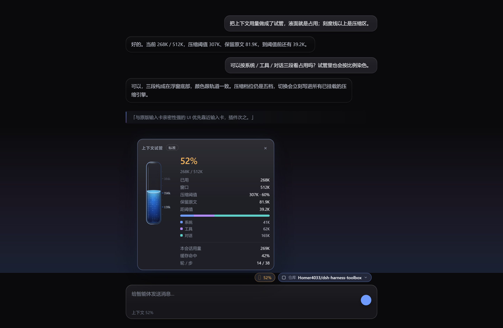
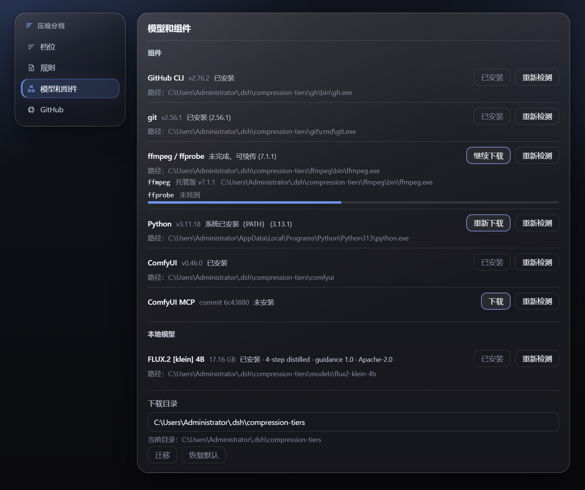
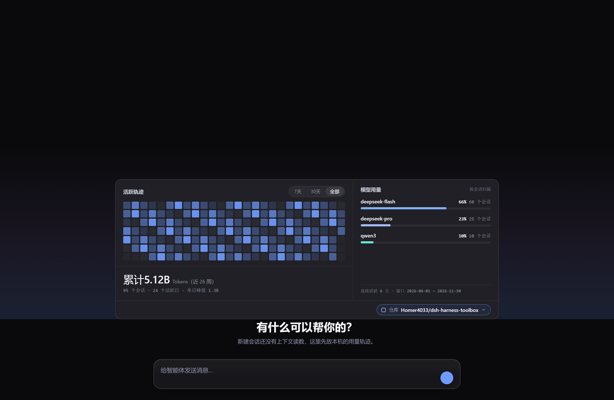

# Compression tiers & workbench

> DSH plugin `dsh-harness-toolbox` · version **2.9.0** · `GPL-3.0-only` · [repository](https://github.com/Homer4033/dsh-harness-toolbox) · [npm](https://www.npmjs.com/package/dsh-harness-toolbox)

Five context compression tiers plus the workbench around them: a context vial above the input, a local usage board for blank sessions, six managed components and one local model, one palette that follows the host theme, global and per-workspace rules, project memory, and per-session repository publishing.

## Table of contents

- [What it is](#what-it-is)
- [Three screens](#three-screens)
- [Five pages](#five-pages)
- [Eight tools](#eight-tools)
- [Install](#install)
- [Boundaries and license](#boundaries-and-license)

## What it is

DSH already ships five compaction tiers and automatic pressure compaction, but nothing puts "where the tier is written, how much is used right now, when it compacts and what it keeps" in one place. That is what this plugin adds:

- **The tier lands in the engines**: pick one and `compression_tiers` syncs it into every mounted preset compaction engine, with no restart; the host's own pressure compaction stays on in every tier.
- **Occupancy you can see**: the vial above the input shows used, threshold and remaining room using the official formula; opening it also lists the system / tools / conversation split.
- **No fake numbers when there is no reading**: before the first message a new session has no `contextPressure`, so the vial is not drawn at all — the chat area carries a read-only local usage board instead.
- **Rules in exactly one place**: the global rules are `<DSH home>/AGENTS.md`; workspace rules own only a managed block at the top of each workspace's `AGENTS.md`. Nothing is copied or cached, and no agent tool can rewrite them.

## Three screens

**The vial and the row above the input** — the trigger shows the occupancy percentage and opens the popover; next to it sits the current session's repository pill, which decides where `github_push` publishes. That row sorts before every host row (`order: -1000`), so top to bottom is "repository row and vial → task bar → input card".

  

**The panel: glass shell, five pages** — it hangs off the sidebar row "compression tiers" and shows one page at a time. Every action button is always rendered: an unavailable one is disabled with the reason in its `title` rather than disappearing. The picture shows the models and components page: two lists in one card, two buttons at each row's trailing edge, path / progress / errors spanning the row.

  

**The usage board of a blank session** — it only appears when the host flags the session as blank (`session.blank`): a 26-week activity trail on the left, model usage on the right, the repository pill in the footer. The host's greeting and input card are shifted to the bottom and the board floats 16px above them. A session with history never draws it.

  

## Five pages

| Page | What it does |
| :--- | :--- |
| **Tiers** | five buttons — `gentle` / `light` / `standard` / `aggressive` / `max`; one click writes every mounted engine |
| **Memory** | the selected workspace's `<project>/memory/` health, index budget, promises and drift, plus three constant actions: re-check / rebuild index / consolidate |
| **Rules** | the upper card edits the whole global `AGENTS.md`; the lower card edits the managed block at the top of the selected workspace's `AGENTS.md`, leaving the rest of the file untouched and hidden |
| **Models and components** | six rows (GitHub CLI / git / ffmpeg+ffprobe / Python / ComfyUI / ComfyUI MCP) plus one local model, FLUX.2 [klein] 4B, and the shared download root below them |
| **GitHub** | account and token scopes, the `gh` device-code login, the network probe; the plugin never reads or stores credentials |

Tier parameters (official formula `floor(min(W × thresholdRatio, W − O − 65,536))`, retained tail `(W − O) × retainRatio`):

| Tier | Auto trigger | Verbatim tail |
| :--- | ---: | ---: |
| `gentle` | 80% | 20% |
| `light` | 70% | 18% |
| `standard` (default) | 60% | 16% |
| `aggressive` | 50% | 10% |
| `max` | 40% | 6% |

## Eight tools

| Tool | What it does |
| :--- | :--- |
| `compression_tiers` | reads or switches the tier; per-route `headroomTokens` overrides are accepted |
| `compression_context` | reads the live occupancy, this tier's threshold and the remaining room |
| `compression_compact` | queues one manual compaction that runs after this turn and resumes automatically; a human message cancels the queue |
| `github_push` | publishes the current workspace: probe → secret scan → 60-second push → failure classification |
| `memory_write` | stores one project memory behind dedupe, near-duplicate and contradicting-rule gates; external sources go to quarantine |
| `memory_search` | term / CJK-bigram search, filterable by kind and scope |
| `memory_reconcile` | read-only health check: overdue promises, index budget, evidence drift, expired entries, duplicates, conflicts, quarantine |
| `memory_dream` | merges near-duplicates offline, retires expired entries, rebuilds `MEMORY.md`; preview by default |

## Install

DSH → **Plugins → Add plugin**, enter `dsh-harness-toolbox` (pin it with `dsh-harness-toolbox@2.9.0`), then open a new session and the "compression tiers" panel is in the sidebar. Requires Node.js ≥ 24.9 and a DSH runtime between `0.2.2-rc.3` (inclusive) and `0.3.0` (exclusive). The full install, upgrade, component and model documentation is in the [README](README.en.md); per-release notes are in the [CHANGELOG](CHANGELOG.md).

## Boundaries and license

- It changes neither the host's compaction algorithm nor the `compaction-basic` row on the host plane; it works only through official slots, official projections and the preset scope.
- Managed components live under a configurable download root and only have their `bin` directories prepended to this process's PATH — the system environment is never written. ComfyUI and ComfyUI MCP only download source trees: no venv, no dependencies, no service.
- There is no repository list and no push button: multiple repositories are handled by the agent calling `github_push` in each session.
- Known limits: the managed sources (gh / git / ffmpeg / Python) are Windows-only; the reasoning slider only appears when the current model really exposes two or more levels; the local model ships no weights and verifies no hashes. The full list is in the [README](README.en.md#compatibility-and-limits).
- Licensed **GPL-3.0-only** (since 2.0.0, because it ports upstream GPL code; 1.10.3 and older were MIT). Forks must keep the attribution chain in [`LICENSE`](../LICENSE), [`NOTICE`](../NOTICE) and [`THIRD_PARTY_NOTICES.md`](../THIRD_PARTY_NOTICES.md). The screenshots are produced by the offline render stage running this repository's own front-end source; their content is invented.
