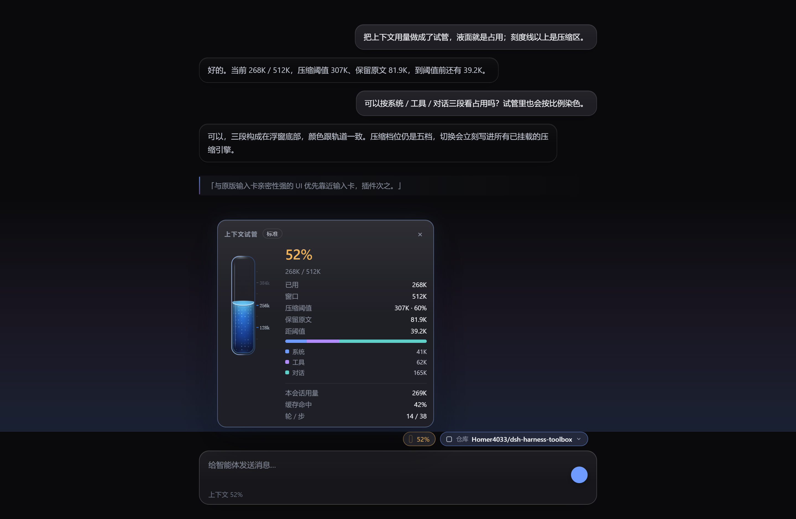
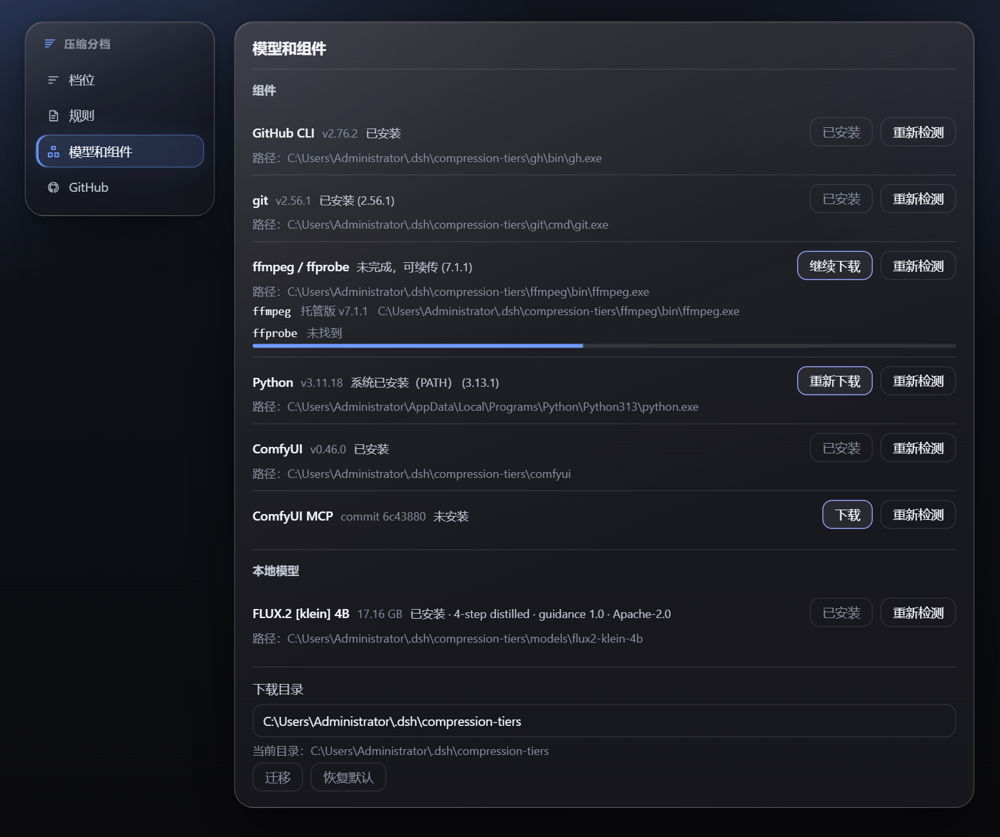
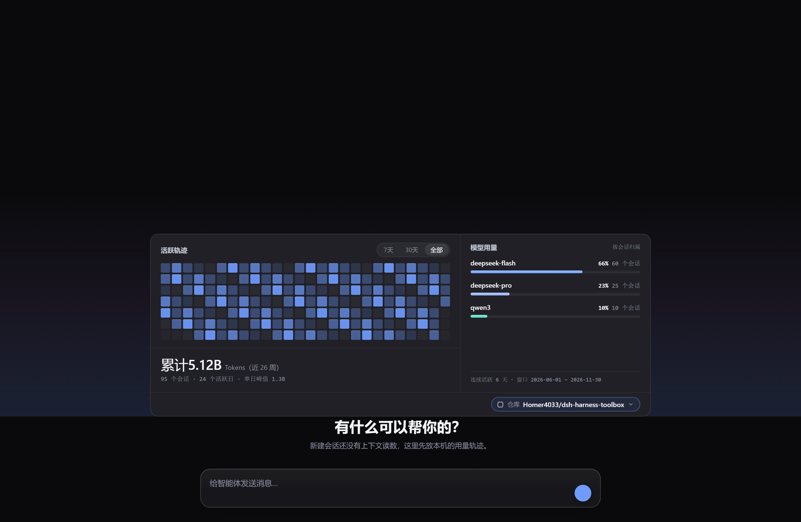

# 压缩分档与综合工作台

> DSH 插件 `dsh-harness-toolbox` · 版本 **2.10.2** · `GPL-3.0-only` · [仓库](https://github.com/Homer4033/dsh-harness-toolbox) · [npm](https://www.npmjs.com/package/dsh-harness-toolbox)

五档上下文压缩，加上一整套围着它的工作台：输入框上方的上下文试管、空白会话的本机用量看板、六套托管组件与一个本地模型、一套跟着 DSH 深浅自动切换的配色、全局与工作区规则、项目记忆，以及按会话绑定的仓库发布。

## 目录

- [它是什么](#它是什么)
- [三个界面](#三个界面)
- [五个分页](#五个分页)
- [八个工具](#八个工具)
- [安装](#安装)
- [边界与许可](#边界与许可)

## 它是什么

DSH 自己已经有五档压缩与自动压力压缩，但没有一个地方把「档位写在哪、现在占了多少、什么时候会压、压掉之后留什么」说清楚。这个插件补的就是这几件事：

- **档位落到引擎里**：选一档，`compression_tiers` 把它同步进所有已挂载的预设压缩引擎并留档，不重启；每档都保留官方自动压力压缩。
- **占用看得见**：输入框上方的小试管按官方阈值公式显示占用、阈值与余量，点开还能读到系统 / 工具 / 对话的三段构成。
- **没有读数时不摆假数字**：新会话在第一条消息之前拿不到 `contextPressure`，试管整支不出现，聊天区中间放一块只读本机会话缓存的本机用量看板。
- **规则只有一份**：全局规则是 `<DSH home>/AGENTS.md`，工作区规则只占各工作区 `AGENTS.md` 开头一个受管块；插件不复制、不缓存，智能体没有改写它们的工具。

## 三个界面

**对话里的试管与输入框上方那一行**——试管触发器显示占用百分比，点开是浮窗；右边是当前会话的仓库胶囊，它决定 `github_push` 推到哪里。这一行排在任何宿主行之前（`order: -1000`），所以上到下是「仓库栏和试管 → 任务栏 → 输入卡」。

  

**面板：玻璃外壳 + 五个分页**——面板挂在左侧栏的「压缩分档」上，一次只显示一页。所有动作按钮常显：条件不满足时置灰并用 `title` 写原因，不会整块消失。下图是「模型和组件」页：一张卡片里两段列表，行尾两个按钮，路径 / 进度 / 错误横跨整行。

  

**空白会话的本机用量看板**——只在宿主把会话标成空白时出现（`session.blank`）：左栏 26 周活跃轨迹，右栏模型用量，卡底放仓库胶囊；宿主的问候语与输入卡整块被推到底部，看板浮在它们上方 16px。有消息的会话永远不画这块板。

  

## 五个分页

| 分页 | 做什么 |
| :--- | :--- |
| **档位** | 五个按钮：`gentle` / `light` / `standard` / `aggressive` / `max`，选一个即写入所有已挂载引擎 |
| **记忆** | 所选工作区 <项目>/memory/ 的状态、索引预算、承诺与漂移；三个常显动作：重新检测 / 重建索引 / 做梦整理 |
| **规则** | 上半张卡编辑全局 `AGENTS.md`（整份）；下半张卡编辑所选工作区 `AGENTS.md` 开头那个受管块，块下面的正文原样保留、面板不显示 |
| **模型和组件** | GitHub CLI / git / ffmpeg+ffprobe / Python / ComfyUI / ComfyUI MCP 六行，加一行本地模型 FLUX.2 [klein] 4B；下面一行是共用的下载根目录 |
| **GitHub** | 账号与 token scope、`gh` 设备码登录、网络体检；插件不读、不存凭据 |

档位参数（官方阈值公式 `floor(min(W × thresholdRatio, W − O − 65,536))`，保留量 `(W − O) × retainRatio`）：

| 档位 | 自动触发 | 逐字保留 |
| :--- | ---: | ---: |
| 极轻 `gentle` | 80% | 20% |
| 轻量 `light` | 70% | 18% |
| 标准 `standard`（默认） | 60% | 16% |
| 积极 `aggressive` | 50% | 10% |
| 最大 `max` | 40% | 6% |

## 八个工具

| 工具 | 作用 |
| :--- | :--- |
| `compression_tiers` | 读或切档位；可带按路由的 `headroomTokens` 覆盖 |
| `compression_context` | 读实时占用、本档阈值与剩余空间 |
| `compression_compact` | 排队一次主动压缩，本轮结束后执行并自动续跑；真人发言优先，排队任务作废 |
| `github_push` | 发布当前工作区：体检 → 密钥扫描 → 60 秒超时推送 → 失败分类 |
| `memory_write` | 写一条项目记忆：去重、近似重复、规则矛盾三道闸；外部来源只进隔离区 |
| `memory_search` | 按词与字符二元组检索，可按 kind / scope 过滤 |
| `memory_reconcile` | 只读体检：逾期承诺、索引超限、证据漂移、过期、近重复、矛盾、隔离区 |
| `memory_dream` | 离线归并近重复、退役过期条目、重建 MEMORY.md，默认只预览 |

## 安装

DSH → **插件 → 添加插件**，输入 `dsh-harness-toolbox`（要锁版本写 `dsh-harness-toolbox@2.10.2`），装完打开新会话即可在左侧栏看到「压缩分档」。要求 Node.js ≥ 24.9、DSH 运行时 `0.2.2-rc.3`（含）到 `0.3.0`（不含）。完整的安装、升级、组件与模型说明见 [README](../README.md)，逐版本变更见 [CHANGELOG](CHANGELOG.md)。

## 边界与许可

- 不改宿主的压缩算法，不碰宿主平面上的 `compaction-basic` 行，只通过官方 slot、官方投影与预设隔离域工作。
- 托管组件装在可配置的下载根目录下，只把 `bin` 目录插到本进程 PATH 最前，不写系统环境变量；ComfyUI 与 ComfyUI MCP 只下载源码树，不建 venv、不装依赖、不启动服务。
- 没有仓库列表，也没有推送按钮：多仓库由智能体在各自会话里调用 `github_push`。
- 已知边界：托管源（gh / git / ffmpeg / Python）只有 Windows；推理滑块只在当前模型真的暴露两档以上时出现；本地模型不内置权重、不校验哈希。完整清单见 [README](../README.md#兼容性与限制)。
- 许可 **GPL-3.0-only**（2.0.0 起，因为移植了上游 GPL 代码；1.10.3 及更早是 MIT）。二次开发须保留 [`LICENSE`](../LICENSE)、[`NOTICE`](../NOTICE) 与 [`THIRD_PARTY_NOTICES.md`](../THIRD_PARTY_NOTICES.md) 的署名链。截图由离线渲染舞台运行本仓库前端源码生成，示例内容为虚构。
