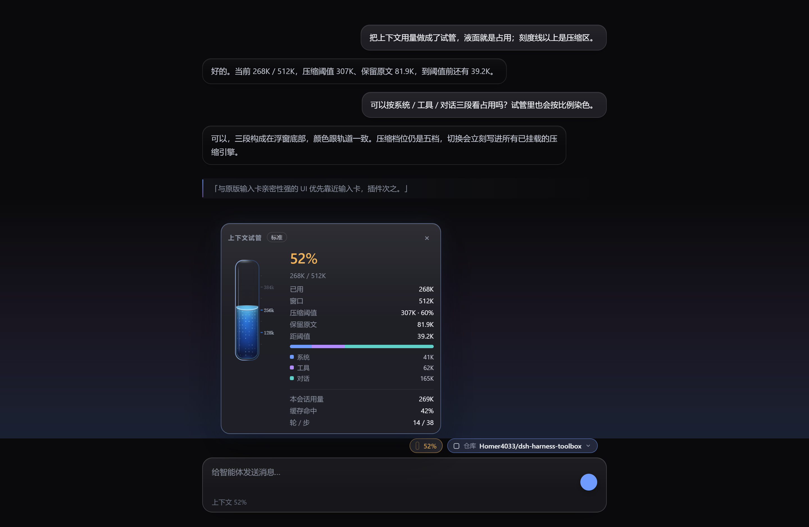
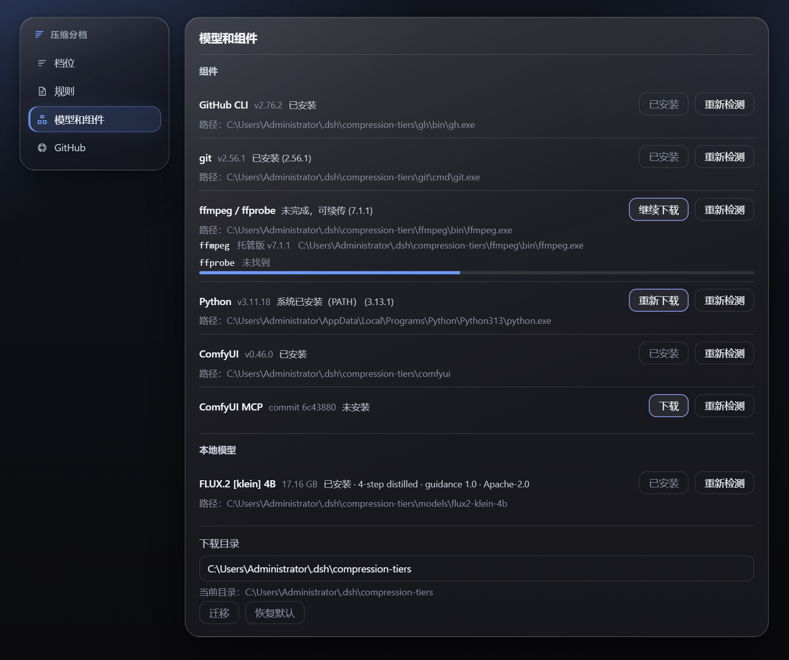
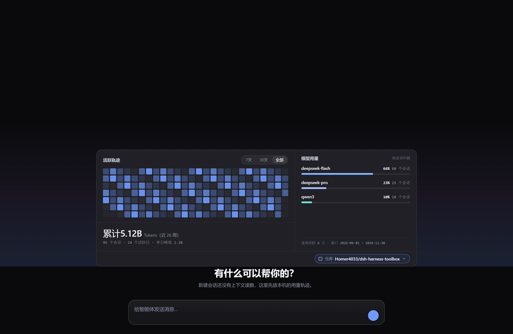

<div align="center">


# Compression tiers & workbench · dsh-harness-toolbox

**Five compression tiers and a full workbench for DeepSeek Harness**

Five tiers · a moving context vial · a local usage board for blank sessions · a local model plus six managed components · two palettes that follow the host theme · global and workspace rules · per-session repository publishing

[**简体中文**](../README.md) | [**English**](README.en.md) · [**CHANGELOG**](CHANGELOG.md) · [**Issues**](https://github.com/Homer4033/dsh-harness-toolbox/issues) · [**npm**](https://www.npmjs.com/package/dsh-harness-toolbox) · [**Plugin detail**](DETAIL.md)

<p>
  <a href="https://www.npmjs.com/package/dsh-harness-toolbox"></a>
  
  
  <a href="https://github.com/Homer4033/dsh-harness-toolbox/actions"></a>
  
  <a href="../LICENSE"></a>
  <a href="../NOTICE"></a>
</p>



<sub>Every screenshot is produced by the offline render stage, which runs this repository's own front-end source; the sessions, repositories and numbers in them are invented.</sub>

</div>

> **Non-Affiliation Disclaimer**
>
> This is an independent open-source DSH plugin. It is not affiliated with, sponsored by, or endorsed by DeepSeek.
> The interface concepts and the ported script come from [Obsidian Prism](https://github.com/RMvdesi/obsidian-prism) (GPL-3.0-only); neither its author nor that project endorses this plugin.

---

## Table of contents

- [Highlights](#highlights)
- [Screens](#screens)
  - [1. The conversation: vial and the row above the input](#1-the-conversation-vial-and-the-row-above-the-input)
  - [2. The panel: glass shell, five pages](#2-the-panel-glass-shell-five-pages)
  - [3. A blank session: the local usage board](#3-a-blank-session-the-local-usage-board)
- [Install](#install)
  - [Way one: from npm](#way-one-from-npm-recommended)
  - [Way two: from a local checkout](#way-two-from-a-local-checkout-developers)
  - [Upgrading and rolling back](#upgrading-and-rolling-back)
- [Usage](#usage)
  - [The five pages](#the-five-pages)
  - [Memory](#memory)
  - [Rules: global and per workspace](#rules-global-and-per-workspace)
  - [Theme art and the glow](#theme-art-and-the-glow)
  - [The models and components page](#the-models-and-components-page)
  - [The row above the input](#the-row-above-the-input)
  - [The usage board of a blank session](#the-usage-board-of-a-blank-session)
  - [The reasoning slider inside the official model menu](#the-reasoning-slider-inside-the-official-model-menu)
  - [The eight agent tools](#the-eight-agent-tools)
- [The five tiers](#the-five-tiers)
- [Managed components](#managed-components)
- [Internals](#internals)
- [Compatibility and limits](#compatibility-and-limits)
- [License, forks and credits](#license-forks-and-credits)
  - [Forking and redistribution](#1-forking-and-redistribution-gpl-30-only-notice)
  - [Upstream projects and credits](#2-upstream-projects-and-credits)
  - [Community](#3-community)
- [Development](#development)

---

## Highlights

- **Five tiers, one click, written where it counts**: `gentle` / `light` / `standard` / `aggressive` / `max` are synced into every mounted preset compaction engine as soon as you pick one, with no restart; the host's own pressure compaction stays on in every tier.
- **Context you can see, reasoning you can touch**: the vial above the input shows the occupancy in real time — the liquid level is `used / window`, the tick marks are the tier's compact threshold. Opening it lists used, window, threshold, retained tail and the distance to the threshold, plus the system / tools / conversation split. The official model menu gains one reasoning slider that writes the session's reasoning effort.
- **A blank session gets a local usage board**: before the first message there is no context reading, so a card floats up instead — the upstream Studio bento layout: left column "activity trail" (header row + a full-width 26-week × 7-day grid + a hairline + the big total), right column "model usage" (one 5px track per model, percentage and session count), with the repository pill in the footer. The host's greeting and input card are pushed to the bottom while the board **stays put**. Every number is read from the host's own session cache (read-only, never copied), and the first message hands the space back to the vial.
- **The local model lives in its own folder**: the models and components page downloads **FLUX.2 [klein] 4B** (the 4-step distilled build of `black-forest-labs/FLUX.2-klein-4B`, Apache-2.0, no login, 18 diffusers files, about 15.98 GB) into a separate `models/` directory under the download root; per-file resume, and only a complete file is renamed into place.
- **One skin pair that repaints the whole app and follows DSH**: the appearance page was removed in 2.8.2, so there is nothing to pick — DSH's own dark / light switch chooses the half. Dark uses 深空黑曜 (near-black slate, indigo accent); light uses 白昼冷晶, upstream Obsidian Prism's white (`#F4F7FB` ground, `#FFF` cards, `#2563EB` accent). The sidebar, bubbles, input card, menus, cards and code blocks repaint together — not just this plugin's own surfaces.
- **The theme art comes with it, always on**: tokens alone leave host surfaces flat, so a layer of art is drawn on top — a static glow at the bottom of the conversation, 16px smoked user bubbles, an accent bar on quotes, an 84%-wide hairline for `hr`, 6px scrollbars, a sheen on the input card. The skin only decides which tokens paint it.
- **The glow is one still gradient**: since 2.4.6 the conversation floor carries a single `linear-gradient` (accent 16% → ice blue 9% at 26% → transparent at 54%); since 2.5.0 the slice under the composer is painted by a `::before` on the same layer at the measured height, so the seam is gone. No canvas, no frames, no animation. The 2.4.0–2.4.5 canvas horizon renderer is gone.
- **Rules exist in exactly one place**: the global rules are `<DSH home>/AGENTS.md`; workspace rules are the `AGENTS.md` at each workspace root (the plugin owns only a managed block at its top, the rest of the file belongs to the workspace). Nothing is copied or cached, no agent tool can rewrite them — only a human, in the panel.
- **Six components, one download root**: GitHub CLI, git, ffmpeg / ffprobe and Python can use a PATH copy or a managed download (resume, self-check, atomic swap, rollback on failure); ComfyUI and the official ComfyUI MCP are two source trees (GitHub archive, no PATH probing) downloaded and swapped the same way. The whole root can be migrated from the panel.
- **One publishing entry point**: `github_push` runs a network probe → secret scan → a 60-second push → failure classification; the repository pill above the input decides where the current session publishes, and it is there in a blank session too.
- **Light and well-behaved**: the panel uses official theme tokens only and never imports a host client package; managed binaries are prepended to this process's PATH, never to the system environment; the one ported UMD module is served from a same-origin route and loaded on demand.

---

## Screens

All three images are **offline stage** output: the stylesheet and the component tree are taken verbatim from `client.js`, dressed in DSH theme tokens and captured in headless Chrome — so the pictures cannot drift from the code. The sessions, repositories, paths and numbers are invented.

### 1. The conversation: vial and the row above the input

<p align="center">
  
</p>

The row right above the input card holds only a right-aligned tool cluster: the vial trigger (with the occupancy percentage), an optional status note, and the **repository pill** for the current session. Opening the vial gives a popover: the liquid level is `used / window`, the ticks on the left are 25% / 50% / 75% of the window and the small line at the top right is the tier's compact threshold; the popover then lists the percentage, `used / window`, the threshold (with its ratio), the retained tail, the distance to the threshold, the system / tools / conversation split with a legend, and a last block with this session's usage. Every number comes from the official projections `contextPressure` / `contextBreakdown` / `tokenUsage` / `sessionStats`; with no reading the vial is not drawn at all (never a fake 0).

That row also decides where `github_push` publishes: the repository selected in the pill is the target of this session.

### 2. The panel: glass shell, five pages

<p align="center">
  
</p>

The panel hangs off the sidebar row "compression tiers" and shows one page at a time, always in this order: **tiers / rules / models and components / GitHub**. Every page is always in the rail — an empty page still renders and says so inside its card (with no registered workspace, the rules page still shows that card and writes "no workspaces yet").

### 3. A blank session: the local usage board

<p align="center">
  
</p>

A blank session has no context reading, so that space holds a **local usage board**: the left column is the activity trail (26 weeks × 7 days, five intensity steps, the big total), the right column is model usage, and the footer carries the repository pill. The host's greeting and input card are shifted to the bottom and the board floats 16px above them. The data is read (never copied) from the host's own session cache, and after the first message the vial takes over. Details in [Usage](#usage).

---

## Install

Requires **Node.js ≥ 24.9** and a DSH runtime between **`0.2.2-rc.3` (inclusive) and `0.3.0` (exclusive)** — that is the `engines` declaration in `package.json`, and the loader refuses anything outside it.

### Way one: from npm (recommended)

1. DSH → **Plugins → Add plugin**, enter the package name `dsh-harness-toolbox` (pin a version with `dsh-harness-toolbox@2.9.0`);
2. after it installs, open a new session — a **compression tiers** panel shows up in the sidebar;
3. the first page is the five tier buttons; pick one.

You can also ask the agent to install the package with `plugin_manager`. Installation and activation belong to DSH — **never hand-edit** the profile's `package.json` / `cordis.patch.yml`.

> The npmmirror in mainland China can lag behind: if the plugin page cannot find a fresh release, check `npm view dsh-harness-toolbox version`, then wait for the mirror or switch registries.

### Way two: from a local checkout (developers)

```bash
git clone https://github.com/Homer4033/dsh-harness-toolbox.git

# In DSH: Plugins → Add plugin → pick this directory
```

Installed as a local link, the host packages (`@deepseek-ai/dsh-home-paths`, `@deepseek-ai/dsh-tools`) come from the runtime; this package only lists them as optional `peerDependencies`. Missing that declaration makes the host half fail to import and the plugin never activates.

### Upgrading and rolling back

- **1.x → 2.0.0 / 2.2.0**: `settings.json` gains an `appearance` block (defaults are `host` / `full` / art on). Rules, components, the download root and session bindings are untouched.
- **2.4.x → 2.5.0**: the pixel companions are removed for good; an old `appearance.mascots` key is ignored (not written back, not an error). A local-model row appears but nothing is downloaded automatically.
- **2.5.x → 2.6.0**: the models and components page gains ComfyUI and ComfyUI MCP (GitHub archives, extracted only — no venv, no launch). Settings, installed components and the download root are untouched, and nothing downloads until you click.
- **2.6.1 → 2.6.2**: the page goes from one card per component to one card holding two lists (six component rows + one model row), with two buttons at the trailing edge and the path / progress / error spanning the row. Data and behaviour are unchanged — pure layout — and the next download resumes from the existing `.part`.
- **2.6.2 → 2.6.3**: the dock row's `order` was raised from 90 to 1000 (reversed again in 2.6.4, so 2.6.3 can be skipped). No data, settings or layout changes.
- **2.6.3 → 2.6.4**: the same row flips to `order: -1000`, i.e. **above** the host's own rows (task list 0 / worktree 5 / goal 10 / queue 20), so top to bottom is "repository row and vial → task bar → input card": native UI that belongs next to the input card stays next to it, the plugin row goes above. Nothing to do after upgrading.
- **2.6.4 → 2.6.5**: that row's width now mirrors the host's dock box (card width minus four insets), so the pill's right edge lands on the task bar's right edge; the vial trigger's surface becomes `--dsw-specific-menu`, the same surface the host uses for that row. Nothing to do after upgrading.
- **2.6.5 → 2.6.6**: no more grey "—" vial. Before the first message there is no `contextPressure` and the host does not paint its own meter either, so a blank session used to show a dead grey capsule; now the vial simply is not rendered and appears with the reading (and disappears with it).
- **2.6.6 → 2.7.0**: a blank session's dock row gains a local usage heatmap (26 weeks × 7 days, five steps) drawn above the vial trigger and giving way once a reading exists. It only reads the host's session projection cache; nothing is written or copied.
- **2.7.0 → 2.7.1**: the same heatmap is rebuilt as a card following the upstream Studio home layout — header row, a 26 × 7 grid whose columns share the card width, a hairline, the big total and one line of summary. Appearance only.
- **2.7.1 → 2.7.2**: the board moves into the chat area and gains the upstream two columns — a blank session no longer occupies the row above the input, the card is a centred overlay, the right column adds model usage, the header gains 7d / 30d / all range tabs, and the repository pill moves to the card footer. The route gains `?range=`.
- **2.7.2 → 2.7.3**: the board is pinned above the composer (16px above its top edge) instead of being vertically centred in an empty chat area. A constant, nothing else.
- **2.7.3 → 2.7.4**: in a blank session the host's "greeting + quick buttons + input card" block is pushed down to the bottom (24px above the chat area's bottom). It only applies while blank (`body[data-ct-blank]` plus one CSS variable), and the first message — the first reading — restores the host's own position.
- **2.7.4 → 2.7.5**: the board no longer follows that block. `placeHeatLayer()` clears the shift variable before measuring, so the card is placed against the host's original seat while only the greeting and input card move down; this also fixes the "resize pops everything back" measurement-order bug. The changelog file moved from the repository root to `docs/CHANGELOG.md`.
- **2.7.5 → 2.7.6**: the board only appears in a session the host itself flags as blank. Blankness used to be inferred from a missing reading, so switching sessions could flash the card (and push the host block down) before the new projection arrived; it now reads `session.blank`, and a session with history always draws just the row above the input.
- **2.7.6 → 2.7.7**: docs and screenshots only. The README becomes one page with three images (conversation / panel / usage board) and gains this English edition; the plugin detail pages are rewritten as "table of contents + prose" instead of a single image; every screenshot is reshot from the 2.7.6 interface by the offline stage, so the pixel companions removed in 2.5.0 and the retired palettes and pages no longer appear. Code, routes, settings and downloaded files are all untouched.
- **2.8.2**: the appearance page is gone. The skin now follows DSH's own dark / light switch with one pair (深空黑曜 / 白昼冷晶), and "follow the host", the motion tiers and the optics switch are removed with it; the silver rim on the composer card is removed on request too. An old `appearance` block is dropped on read and never written back — no configuration change needed.
- **License**: since 2.0.0 the whole package is **GPL-3.0-only** (it ports upstream GPL code); `1.10.3` and older are still MIT.
- **Uninstalling**: remove it from the plugin page. Managed component directories stay where they are; delete the directory to clean up completely.

A successful install is whatever the plugin page's `application` result and the panel / tools in a new session say — not the logs and not the download progress.

---

## Usage

### The five pages

| Page | What it does | Single source of truth |
| :--- | :--- | :--- |
| **Tiers** | five buttons, one click writes every mounted preset compaction engine | `COMPRESSION` in `src/levels.js` |
| **Memory** | store health of the selected workspace, injected-index budget, promises and drift, plus three maintenance actions | that workspace's `<project>/memory/` (`entries.jsonl` + the generated `MEMORY.md`) |
| **Rules** | the global rules edited as one file; the lower card edits the selected workspace's supplement (prepended to its `AGENTS.md`) | `<DSH home>/AGENTS.md`, `<DSH home>/storages/workspace.json` + each workspace's `AGENTS.md` |
| **Models and components** | status, download, re-check and the shared download root of six components, plus one local model | `COMPONENTS` in `src/components.js`, `MODELS` in `src/models.js` |
| **GitHub** | account, token scopes, device-code login, network probe | `gh`'s own storage (the plugin never reads credentials) |

Every action button is always rendered: when a condition is not met it is disabled with the reason in its `title` instead of disappearing. Below 720px of panel width the rail becomes a wrapping horizontal bar.

### Rules: global and per workspace

The global rules are written as one file to `<DSH home>/AGENTS.md`. Workspace rules only own a **managed block** which is prepended to the workspace's `AGENTS.md` (created when missing); everything below the block is preserved verbatim and is never shown in the panel. Both writes are atomic, strip a BOM, normalise CRLF to LF and keep a single trailing newline; the limit is 100,000 characters per write and exceeding it returns 413 instead of truncating. The system prompt only carries a 2,000-character summary of the newest rules.

The managed block only counts at the very top of the file: the fence must be the first non-empty line and the end marker must be a line of its own — mentioning the markers inside the prose does not count (this repository's own `AGENTS.md` mentions them twice). A half fence (start without end) is treated as an empty block and saving never creates a second start marker; a whole-line marker inside the supplement returns 400 and the file is not touched.

### Memory

The Memory page keeps **conclusions across sessions**, which is not the same job as compaction (rewriting this session's history). The store lives in the project, not inside the plugin directory: the selected workspace gets `<project>/memory/` with two append-only JSONL files (`entries.jsonl`, `quarantine.jsonl`) and a **plugin-generated** `MEMORY.md` index. That index is what a session injects at start, and it has a hard budget of **200 lines / 25 KB** — going over it is reported as over budget instead of being truncated silently. A `MEMORY.md` without the plugin marker is moved aside once and reported, never silently overwritten.

Four tools read and write it, and `memory_write` only stores what a later session would otherwise re-derive: decisions and their reasons, rejected options, verified rules, failure root causes, promises, open questions. Every write passes three gates — an exact duplicate returns the existing entry instead of storing a second copy; a near-duplicate (token / CJK-bigram overlap ≥ 0.8) needs `supersedes` or an explicit `force`; a claim that contradicts an existing rule must supersede it. `source: "external"` (web pages, asset stores, third-party PRs) only ever goes to quarantine: it can never become a rule or a decision and never enters the index. `memory_search` ranks by term and CJK-bigram overlap, `memory_reconcile` reports overdue promises, missing evidence paths, expired entries, near-duplicates, conflicts and the quarantine, and `memory_dream` merges near-duplicates offline, retires entries past `expiresAt` and rebuilds the index (preview unless `apply: true`).

The panel only does three things: pick a workspace, show the health (entries, promises, index lines/bytes, drift, quarantine) and trigger "Re-check / Rebuild index / Consolidate". Entries themselves are written only by the tools; the panel never invents one. The route is `GET/POST /compression-tiers/api/memory`.

### Palettes: 深空黑曜 in the dark, 白昼冷晶 in the light

The appearance page was removed in 2.8.2: no palette picker, no "follow the host", no motion tier and no optics switch. There is one skin pair, and DSH's own dark / light switch decides which half is used, live:

| Theme | Attribute | Canvas | Accent | Notes |
| :--- | :--- | :--- | :--- | :--- |
| **深空黑曜** | `body[data-ds-dark-theme]` | `#0A0A0C` | `#6F9BFF` | used on DSH's dark theme: near-black slate with an indigo accent |
| **白昼冷晶** | default (light) | `#F4F7FB` | `#2563EB` | used on DSH's light theme: upstream Obsidian Prism's white (`#F4F7FB` ground, `#FFF` cards, `#2563EB` accent) |

The skin goes through the host's official theme service (`overrideTokens`): the panel page, the dock row and the portal menus each keep their own token set, and the whole set is layered onto the host theme so the sidebar, bubbles, input card, menus and code blocks repaint together. An old `appearance` block (including the 2.0.0 `warm` / `alabaster` ids) is dropped on read and does not affect the upgrade.

### Theme art and the glow

Tokens alone leave host surfaces flat, so a layer of art is drawn with **semantic anchors**: a static gradient at the bottom of the conversation, smoked 16px user bubbles (2.2% sheen, 1px stroke, inner highlight, deep shadow), a 1.5px accent-to-violet bar on quotes, an 84%-wide hairline gradient for `hr`, 6px slim scrollbars and a 3% sheen on the input card; body text line-height opens up to 1.72. Every selector uses DSH's own semantic attributes (`[data-conversation-region]`, `[data-message-bubble]`, `[data-composer-card]`, `[data-conversation-scroll]`) and never a hashed class name — where it does not match, nothing happens.

The conversation floor carries **one linear gradient**: accent 16% at the bottom edge, ice blue 9% at 26%, fully transparent at 54% — no canvas, no frames, no animation. The composer seat's own mask used to cut it off, so the seat paints the same gradient again with a `::before` (`z-index: -1`, above the seat background and below the input card), sized by `--ct-glow-height`, which is measured from the chat region and written onto the seat's inline style; its top edge is faded with `mask-image` at the mask's own slope, so there is no step. The input card and its mask still belong to the host: the card stays opaque and content is clipped above it.

The art layer is always on since 2.8.2 (there is no optics switch any more). While it is on, the host's pale stats row (`[data-composer-stat]`) and the `○ 5%` context ring in the composer dock (`aria-haspopup='dialog'`) are hidden — those numbers already live in the vial popover.

### The models and components page

One card holding two lists: six managed components on top, one local model below. Each row is name + pinned version, state, and two buttons at the trailing edge (download, re-check); path, progress and errors span the row, rows are not cards, and a row whose status has not arrived still renders with disabled buttons. The download root (`toolsPath` in `settings.json`) sits below the list; migrating it takes an absolute path, moves all six components together, and returns 409 while any download is running.

There is one local model: the 4-step distilled **FLUX.2 [klein] 4B**.

| Item | Value |
| :--- | :--- |
| Model | [`black-forest-labs/FLUX.2-klein-4B`](https://huggingface.co/black-forest-labs/FLUX.2-klein-4B), 4-step distilled; the [official ModelScope mirror](https://modelscope.cn/models/black-forest-labs/FLUX.2-klein-4B) has the same paths and bytes |
| License | Apache-2.0; both Hugging Face and ModelScope download without a login |
| Size | 18 files, about **15.98 GB** |
| Location | `<root>/models/flux2-klein-4b` (a directory of its own, moved along with the components) |

Only the diffusers minimum set is fetched (transformer, both text encoders, VAE, tokenizer / scheduler / configs); the duplicate single-file transformer and the three preview images in the repository are skipped. Each file downloads with HTTP Range resume — a `.part` survives a failure and continues next time, and only a complete file is renamed into place, which is why there are exactly three states: missing / partially downloaded / installed. The route is `GET/POST /compression-tiers/api/models`; only one download runs at a time and a second click returns 409.

Endpoints are tried **ModelScope first, then the `hf-mirror.com` mirror, then `huggingface.co`**: `huggingface.co` is unreachable on most networks in mainland China (the first release only knew it, which is where `fetch failed (gave up after 4 attempts)` came from); `hf-mirror.com` connects but redirects large files to `cas-bridge.xethub.hf.co` at about 150 KB/s measured (a day for 15.98 GB); ModelScope carries an official BFL mirror with the same 18 files, the same paths and the same bytes, measuring 33–38 MiB/s on the same machine. The `.part` is shared across endpoints. Set `DSH_HF_ENDPOINT` to prefer another mirror. When every endpoint fails, the row's error names **each host and its reason** instead of a bare `fetch failed`.

### The row above the input

`conversation.input.dock` is the full-width slot right above the input card, and the plugin registers `compression-repo` there:

- **vial trigger**: the current occupancy percentage; opens the context vial popover;
- **repository pill**: binds an online repository to the current session, which is where `github_push` publishes by default. It renders in a blank session too, and its menu opens upward;
- **status note**: one line to the left of the pill while the repository list is loading or a binding failed to save.

The slot sorts rows by `order` ascending (small on top) and the principle is **native UI that belongs next to the input card comes first, plugin surfaces after**: the agent's task list (`todo`, order 0), worktree progress (5), goal bar (10) and queue (20) all hug the input card, and this row takes `order: -1000` to sit above all of them. Top to bottom is therefore always **repository row and vial → task bar → input card**.

The liquid in the vial is not an image: the ported `vial-core.js` runs a 24-node shallow-water simulation on a 96×220 canvas, so the surface sloshes when you tilt or open the popover. Menus open upward by default and only flip down when there is less than 200px above and more below; ↑ / ↓ / Home / End / Enter / Esc all work.

### The usage board of a blank session

The local usage board only floats up when the host itself flags the session as blank (`session.blank`, i.e. no message yet): there is no `contextPressure` then, and the vial is not rendered at all. A session with history **never draws the board** — not even while switching, before the new projection arrives — so it cannot flash and cannot push the host block down. The board follows the upstream Studio home bento card:

- **Placement**: the card is portalled to `body` (`.ct-heat-layer`, `position: fixed`) and placed from the measured chat and composer rectangles — centred on the chat area, bottom edge 16px above the composer's top edge; on a short window it shrinks from 900 down to 360px rather than covering the host's greeting. **The row above the input is not rendered at all in a blank session**, and the input card stays at the bottom;
- **the block moves down with it**: the host centres "greeting + quick buttons + input card" in the chat area; in a blank session it is pushed to the bottom (24px above the chat area's bottom) while the board keeps the host's **original** seat, so only that block travels. The shift is controlled by `body[data-ct-blank='on']` plus one CSS variable, and both are removed with the first reading;
- **two columns**: left "activity trail" (header row → full-width grid → hairline → big total + one line of summary), right "model usage" (one 5px track per model, percentage, session count); below 660px the columns stack;
- **header row**: "activity trail" on the left, the 7d / 30d / all range tabs on the right — switching refetches and rescales the intensity against the window's peak;
- **grid**: 26 weeks × 7 days, 182 cells, column-major (one column per week, Monday through Sunday, Monday-aligned); days after today and days outside the window stay blank; columns share the card width and cells scale into squares;
- **five intensity steps**: one cell per **local day**, coloured by the log of that day's tokens against the window peak, five steps; days with no usage get a faint base. Hovering floats a glass capsule with the date and "tokens · sessions";
- **model usage**: each session is bucketed by the model it last used (the cache only has `modelSelection.val.lastUsed`, which is why the card says "by session"), up to six rows by share;
- **read-only data**: it reads the host's own `<DSH home>/storages/session_projcache/sessions/*.json`; a session's tokens are `uncachedInputTokens + outputTokens + cacheReadTokens + cacheWriteTokens`, bucketed by the local day of `identity.createdAt`. Broken JSON and sessions without a usage row are skipped, a missing directory is an empty grid — **no invented zeros and no fake data**;
- **route**: `GET /compression-tiers/api/usage?range=7d|30d|all` returns the grid and the summary per window; the client caches each window for 60 seconds.

### The reasoning slider inside the official model menu

The model button in the composer opens the official model menu: two rows at the root (model / reasoning effort) and, below them, the rail this plugin injects.

- Drag the rail, click a level, or press ↑ / ↓ / Home / End: the write happens immediately and both the official row and the trigger's subtitle update;
- level names (off / low / high / max …) come from the host with the model — the plugin neither translates nor hard-codes them;
- geometry follows the reference plugin [`dsh-codex-effort-slider`](https://github.com/Microqian2th/dsh-codex-effort-slider): a 28px capsule rail, a white knob as tall as the rail, 3px level dots, the fill ending at the knob's centre; past the middle level the rail "powers up" — a violet nebula covers the filled part, a sweep crosses it and 22 star motes drift across, brightest at maximum;
- while writing, the rail goes busy and locks; a rejected write (the session is held by a writer, say) prints the reason under the rail and the knob returns to the level the host confirmed.

Mounting is fail-open: no `modelDirectories` service, a model without `reasoning.efforts`, a single level, a closed menu or a rejected write all leave the official menu exactly as it was. The anchors are semantic only (`aria-haspopup="menu"` + `aria-controls` to find the menu, a `role="menuitem"` row whose leading label reads "reasoning effort", `[data-composer-card]` to decide ownership) — never a hashed class name.

### The eight agent tools

| Tool | What it does |
| :--- | :--- |
| `compression_tiers` | reads or switches the tier; per-route `headroomTokens` overrides are accepted (`provider model headroom [retain]` lines) |
| `compression_context` | reads the live occupancy, this tier's threshold and the remaining room; the `[context]` line at the end of a conversation carries the same numbers |
| `compression_compact` | queues one manual compaction that runs after this turn and resumes automatically; a message you send meanwhile cancels the queue or blocks the resume |
| `github_push` | publishes the current workspace: probe → secret scan → 60-second push → failure classification; a secret hit blocks the push unless a human confirms with `force: true` |
| `memory_write` | stores one project memory behind three gates: exact dedupe, near-duplicate supersede, contradicting-rule replacement; external sources go to quarantine |
| `memory_search` | deterministic term / CJK-bigram search over the store, filterable by kind and scope, quarantine excluded by default |
| `memory_reconcile` | read-only health check: overdue promises, index budget, evidence drift, expired entries, duplicates, conflicts, quarantine |
| `memory_dream` | merges near-duplicates offline, retires expired entries and rebuilds the index; preview unless `apply` is true |

Manual compaction always yields to a human: speaking cancels the queue, and a compaction that is already running is not interrupted — it just does not inject a resume message afterwards. Multiple repositories are handled by the agent calling `github_push` in each session; the plugin has no repository list and no push button.

---

## The five tiers

| Tier | Auto trigger | Verbatim tail | Positioning |
| :--- | ---: | ---: | :--- |
| `gentle` | 80% | 20% | the official default; the most expensive, the latest |
| `light` | 70% | 18% | one step earlier than the official default |
| `standard` | 60% | 16% | **default** |
| `aggressive` | 50% | 10% | cost first |
| `max` | 40% | 6% | the cheapest |

The official threshold formula is kept verbatim: `floor(min(W × thresholdRatio, W − O − 65,536))`, with a verbatim tail of `(W − O) × retainRatio`. The panel and the vial display the same formula, and `0.80` is the most expensive tier, not the middle one.

---

## Managed components

The six managed components live under one configurable root. The first four are executables: a copy on the system PATH is detected, the managed copy wins, and it is prepended to this process's PATH (the system environment is never touched). The last two are source trees — no executable, and therefore no PATH entry.

| Component | Managed source | Location | PATH directory |
| :--- | :--- | :--- | :--- |
| GitHub CLI | `cli/cli` release, pinned `2.76.2` | `<root>/gh` | `<root>/gh/bin` |
| git | MinGit, pinned `2.56.1` | `<root>/git` | `<root>/git/cmd` |
| ffmpeg / ffprobe | gyan.dev essentials (floating release) | `<root>/ffmpeg` | `<root>/ffmpeg/bin` |
| Python | python-build-standalone, pinned `3.11.18+20261110` | `<root>/python` | `<root>/python`, `<root>/python/Scripts` |
| ComfyUI | `Comfy-Org/ComfyUI` archive, pinned to tag `v0.46.0` | `<root>/comfyui` | none |
| ComfyUI MCP | `Comfy-Org/comfy-mcp` archive, pinned to commit `6c43880` | `<root>/comfy-mcp` | none |

- **Downloads**: HTTP Range resume, a 20-minute timeout, automatic retries with exponential backoff, and a "no new bytes for 60 seconds" rule that treats a half-open connection as a dropout (so the progress bar can never freeze at one number); extraction happens in `<root>/.staging/<id>` and every build self-checks first (executables run `--version` / `-version`, source trees look for `main.py` / `pyproject.toml`), after which the whole tree is swapped atomically — on failure the old copy is restored and the `.part` is kept.
- **Source trees download only**: the result is two trees you can inspect and take over yourself; the plugin creates no venv, installs no torch and never launches ComfyUI — `<root>/comfyui/main.py` and `<root>/comfy-mcp/pyproject.toml` are the proof of installation. GitHub's `/archive/<ref>.zip` wraps the repository in an extra `ComfyUI-0.46.0/` directory, which is stripped so the install directory is the repository root.
- **Windows locks**: the swap goes through `moveIntoPlace()` — rename with backoff and, if that still fails, a copy — so a binary still being scanned by antivirus no longer turns into `EPERM`.
- **Download root**: `toolsPath` in `settings.json` (empty means `<DSH home>/compression-tiers`). Migration takes an absolute path only, moves all six components together, returns 409 while a download runs, refuses an existing target, degrades to copy-then-delete across volumes and rolls the target back (keeping the source) when a copy fails halfway, so the next attempt is still possible.
- **Routes**: `GET/POST /compression-tiers/api/components` (read the six rows / `{id, action:'download'}`) and `GET/POST /compression-tiers/api/tools` (read the root / `{action:'migrate', path}`).
- **Boundary**: the managed sources for gh / git / ffmpeg / Python are Windows-only; Linux and macOS only probe PATH and report "unavailable on this system". The ComfyUI and MCP archives are platform-independent and install on both.

---

## Internals

<details>
<summary><strong>Halves, vial physics, thresholds, palette plumbing and safety boundaries</strong></summary>

**Version `2.9.0`** changes neither the host's compaction algorithm nor the `compaction-basic` row on the host plane; it works only through official slots, official projections and the preset scope:

- **Two halves, Host and Client**: `index.js` registers the eight tools, the system-prompt summary, the HTTP routes and a reconciler that syncs the tier into the compaction engine inside the preset scope; `client.js` renders the sidebar panel and the row above the input using only `ctx.slots`, `ctx.locale`, `ctx.effect` and theme tokens. The panel imports no host client package — dropdowns, menus and buttons are all self-drawn.
- **The ported module loads as a plain `<script>`**: `vial-core.js` (about 75 KB) is the upstream 1.0.8-beta.1 script served from the same-origin route `GET /compression-tiers/vendor/<name>` (a whitelist of exactly this one file name, `text/javascript; charset=utf-8`, `cache-control: public, max-age=3600`, with `?v=2.9.0` in the URL so a stale cache cannot outlive a release). That keeps the UMD body out of `client.js` and avoids `eval`. After the 2.4.6 horizon renderer and the 2.5.0 companion rig were removed, the whitelist went from three names to one.
- **The vial is physical**: `vial-core.js` exports `createWaterVialPhysics` and `mountPhysicalWaterVial`, running a 24-node shallow-water simulation with damping and surface tension on a 96×220 canvas; the host drives RAF and `step(dt)` and stops redrawing when `isSettled()` is true. The fill ratio and the threshold tick are computed by the panel from the official formula — the physics layer knows nothing about tokens.
- **Numbers come from official projections**: occupancy and window from `useProjection('contextPressure')`, the three-part split from `useProjection('contextBreakdown')`. With no reading at all (before the first message of a new session) the vial is not rendered — the host does not paint its own `ContextMeter` then either, so there is no dead grey "—". The popover environment (port, theme, `reducedMotion`) is passed in by the client; the ported module reads no host globals.
- **Repainting has two legs**: the plugin's own panel, dock and popovers use the tokens declared on `.ct-skin[data-palette='…']` (so the host UI is unaffected and the plugin still has a skin when the theme service is missing); the whole DSH interface is repainted by layering `ctx.theme.overrideTokens('compression-tiers', tokens)`, which the host writes as inline CSS variables on `<body>`. Every token must be a `{ light, dark }` pair (the service deliberately rejects bare strings) and both modes must be complete — that is exactly how the skin follows DSH's light/dark: the host picks which half to use.
- **A palette only covers its own root**: `.ct-skin[data-palette='…']` is declared on the panel page, the dock row and portalled menus, so those values never leak into the host UI; `host` is the empty set and leaves the official theme alone. Both palettes carry two local token sets: the default block is what a light host sees, and `body[data-ds-dark-theme]` (the attribute the host's own theme presenter writes) switches to the dark one. `color-scheme` is not written here — `html` already has the host's.
- **The skin never flips the user's theme**: 2.0.0 used to set the host appearance preference to dark when a dark palette was picked; 2.2.0 removed that write, because each palette carries both modes and follows the official theme instead.
- **The art layer only speaks semantic attributes**: `applyOptics()` writes `data-ct-palette` / `data-ct-art` on `<body>`, every art rule in the stylesheet starts with `body[data-ct-art='on']`, and the selectors use only DSH's own `[data-conversation-region]`, `[data-conversation-scroll]`, `[data-message-bubble]`, `[data-composer-card]`, plus the conversation's `hr` and `blockquote`. No match, no effect; no hashed class names.
- **The slider hangs off the official row and writes through the official path**: the client injects `modelDirectories`, reads `groups[].models[].reasoning.efforts` from `store.getSnapshot()`, writes with `directory.select({ provider, model, reasoningEffort })` and follows the official row through `store.subscribe()`. The DOM bridge uses semantic attributes only and identifies the row by its label rather than its position (with exactly two rows in the root pane the official layout is the fallback; with more rows and no label match it injects nothing). The directory is re-resolved on demand — `directoryFor()` throws before the session scope is ready, so it retries with 60 / 240 / 540 / 960 / 1500 / 3000ms backoff — and a replaced instance means dropping the old subscription and subscribing again. A rejected write prints the reason under the rail and returns the knob to the level the host confirms; it never fakes success.
- **State lives in one file**: `<DSH home>/compression-tiers/settings.json`, always written as "temp file + rename"; a hand-broken JSON falls back to defaults instead of crashing. `appearance` is normalised on both read and write, so an unknown palette or motion falls back to the default rather than erroring.
- **Rule writes**: BOM stripped, CRLF to LF, a single trailing newline kept, a 100,000-character limit (413 with no write beyond it); the system prompt carries only the newest 2,000-character summary and never the whole file, and the summary is never written back.
- **Local usage is read-only**: `<DSH home>/storages/session_projcache/sessions/*.json` is written by the host; the plugin only reads it, never writes it, never copies it.
- **Managed installs**: download → `.staging` → self-check → `moveIntoPlace()` atomic swap → rollback on failure. A finished archive is reused on the next attempt instead of being downloaded twice — but **only a complete download becomes an archive** (a body shorter than `content-length` is a retryable resume), and an archive that does not yield the expected binary, or whose staged build fails its self-check, is deleted first so the next attempt downloads fresh instead of unpacking the same broken file again.
- **Publishing boundary**: a session's bound repository only changes `github_push`'s target — no clone, no branch switch, no change to the session's working directory; bindings are normalised to `owner/name`, invalid values are dropped, at most 200 are kept.
- **Tests**: `npm test` runs 270 `node:test` cases covering the tiers and the formula, routes, engine sync, the global rules and the workspace managed block (create / replace / keep the body / read only the block / a whole-line marker returns 400), `gh` / components / the download root (short reads, the 60-second stall, the PowerShell fallback, a failed copy that leaves the second half retryable), source-tree components (`any` assets, stripping GitHub's wrapper directory, marker-file detection, no PATH entry, one row shape, dock ordering), the component and model lists (one card, two lists, two trailing buttons, no `ct-component`), the local model (pinned file list and total bytes, endpoint order and fallback, `DSH_HF_ENDPOINT`, three states, `.part` resume, 409 while downloading, 404 for an unknown id), **the local usage heatmap** (four token buckets and invalid ones, broken JSON / no usage row / missing directory, 26-week Monday alignment and future days, several sessions on one day, monotone intensity up to 5, local-day bucketing, the three windows, 182 cells for a blank session, yielding to a reading, no board without data, the 16px gap above the composer, the seat shift only while the switch is present, and **blankness read only from the host's `session.blank`**), the publishing flow, the ported UMD loading and attribution (the whitelist is `vial-core.js` alone), the single skin pair's token sets / an old `appearance` block dropped on read / one skin layer, the slider (level mapping, rail geometry, semantic anchors, directory backoff and rebuild, writes and rollback), renderer fallback, the settings snapshot push, the `::before` glow and `--ct-glow-height`, hiding the host's context ring, the manifest and the locale; CI runs the same suite on Windows and Linux.

</details>

---

## Compatibility and limits

- **Window size**: the five tiers are designed for windows of 256k tokens or more; on a 128k window only the retained tail differs, and a 64k window is pinned by the official 65,536-token output headroom — use `compression_tiers`'s `routeLines` to give that route a smaller `headroomTokens`.
- **Host plane**: only the compaction engines inside the preset scope are updated. If another plugin manages the same engines, the two overwrite each other — keep one.
- **Network**: GitHub and npm operations need `github.com`; when a proxy dies or DNS is poisoned, the network probe tells you which. ffmpeg needs `www.gyan.dev`; git / Python / ComfyUI / MCP need `github.com`; the local model tries `modelscope.cn`, then `hf-mirror.com`, then `huggingface.co`.
- **Managed copies shadow system versions**: once a managed git / Python is installed, this process prefers it; delete `<root>/git` or `<root>/python` and restart to fall back.
- **ComfyUI and MCP are code only**: those rows download repository archives, leaving two source trees. The plugin creates no venv, installs no dependencies (torch is yours) and starts nothing; "installed" only means the archive is extracted and the marker file is there. Delete the directory to remove it.
- **The reasoning slider is not in every session**: it appears only when the current model really exposes `reasoning.efforts` (two or more levels). Sub-agent sessions, hosts without a `modelDirectories` service and models without reasoning levels render nothing at all.
- **The local model is yours to download**: FLUX.2 [klein] 4B is about 15.98 GB; the plugin only downloads it and checks file sizes — it ships no weights and verifies no hashes. Delete `<root>/models/<id>` to clean up. A `.part` left by a dropped connection resumes next time, and a download that stalls for 60 seconds reconnects and resumes.
- **Art is decoupled from the palette**: since 2.4.2 "follow the host" also draws the art layer with host tokens instead of turning it off; the optics switch stays visible and clickable, and turning it off only removes the art, leaving the palette tokens applied.
- **Screenshots and rendering**: the three images in the README and the detail pages come from the offline stage (same-origin static preview plus headless Chrome running this repository's `client.js`). **The final look in a real DSH window still needs a page refresh to confirm**; the reasoning slider has no image of its own — its mounting, drag writes, official-row sync and rejected-write rollback are covered by unit tests.
- **Repository UI**: there is no repository list and no push button. Multiple repositories are the agent's job in each session via `github_push`; the pill only picks the current session's target.

---

## License, forks and credits

### 1. Forking and redistribution (`GPL-3.0-only` + `NOTICE`)

**dsh-harness-toolbox** (`Copyright (C) 2026 Homer and the dsh-harness-toolbox contributors`) is released under the **[GNU General Public License v3.0 (`GPL-3.0-only`)](../LICENSE)**, together with **[`NOTICE`](../NOTICE)** and **[`THIRD_PARTY_NOTICES.md`](../THIRD_PARTY_NOTICES.md)**.

If you modify, fork, port or repackage this project, you must:

1. **Stay copyleft**: any derivative plugin that contains or modifies this project must be released under **GPL-3.0** with its complete corresponding source code.
2. **Keep the attribution chain**: the derivative repository's root must keep [`LICENSE`](../LICENSE), [`NOTICE`](../NOTICE) and [`THIRD_PARTY_NOTICES.md`](../THIRD_PARTY_NOTICES.md), and its README must keep the links to the original author `RMvdesi` and the upstream repository `RMvdesi/obsidian-prism`.
3. **Mark your changes**: modified upstream files must carry the modification date and a summary of the change (this project does that in each vendor file's header); never publish a derivative under the name "Obsidian Prism official".

> **License change**: `1.10.3` and older were released under MIT; since `2.0.0` the package ports GPL-3.0-only upstream code and is therefore **GPL-3.0-only** as a whole. Versions already published under MIT are unaffected.

#### Attribution template for downstream READMEs

```markdown
> Built upon [dsh-harness-toolbox](https://github.com/Homer4033/dsh-harness-toolbox) by Homer, licensed under [GPL-3.0](https://www.gnu.org/licenses/gpl-3.0.html).
> Optical vial and motion concepts ported from [Obsidian Prism](https://github.com/RMvdesi/obsidian-prism) by [@RMvdesi](https://github.com/RMvdesi) (GPL-3.0-only). Upstream component notices are preserved in `NOTICE` and `THIRD_PARTY_NOTICES.md`.
```

### 2. Upstream projects and credits

- **[RMvdesi/obsidian-prism](https://github.com/RMvdesi/obsidian-prism)** (`1.0.8-beta.1`) — `GPL-3.0-only`, `Copyright (C) 2026 RMvdesi`: this project ports `vial-core.js` (the shallow-water vial) and rebuilds the panel shell, the two palettes and the motion tiers in its optical interface language; that file's header records its origin and the modification. The previously ported `dual-mascot-rig.js` (the pixel companion rig) was removed on request in 2.5.0 and is no longer included.
- Upstream itself absorbed several MIT projects (compatible with GPL-3.0); the full notices live in [`THIRD_PARTY_NOTICES.md`](../THIRD_PARTY_NOTICES.md). Those directly relevant here:
  - **[0DNANCY/agy-claude-style](https://github.com/0DNANCY/agy-claude-style)** — `MIT`, `Copyright (c) 2026 0DNANCY` (the palette framework and the pixel-pet base).
  - **[wp3171216237/dsh-TUI](https://github.com/wp3171216237/dsh-TUI)** — `MIT`, `Copyright (c) 2026 chimney (@wp3171216237)` (the Deepy desktop-pet outline palette reference).

### 3. Community

Questions and ideas go to [Issues](https://github.com/Homer4033/dsh-harness-toolbox/issues); changes go through Pull Requests. Run `npm test` and `npm run check:secrets` before submitting.

---

## Development

```bash
npm test               # node:test: tiers, routes, state, engine sync, rules, GitHub, publishing, components, heatmap, the ported module and the manifest
npm run check:secrets  # repository secret scan (shared by CI and local runs)
```

Docs: this file and the Chinese original ([`../README.md`](../README.md)) are for users; the plugin detail pages are [DETAIL.md](DETAIL.md) / [DETAIL.zh.md](DETAIL.zh.md). Per-release notes live in [CHANGELOG.md](CHANGELOG.md), older ones are archived in [HISTORY.md](HISTORY.md), and the panel / popover implementation spec is [UI.md](UI.md). The screenshots are generated by `scripts/stage/render.mjs` + `scripts/stage/shoot.mjs` (not part of the package).

```text
dsh-harness-toolbox/
├── package.json                  # manifest: engines.dsh, GPL-3.0-only, files/exports (vendor included)
├── LICENSE / NOTICE              # the full GPL-3.0 text + derivative attribution and changes
├── THIRD_PARTY_NOTICES.md        # full notices for upstream and the MIT projects it absorbed
├── icon.svg                      # the panel icon
├── index.js                      # host half: eight tools, system prompt, panel routes, reconciler, vendor route
├── client.js                     # client half: sidebar panel (five pages), composer dock, vial, usage heatmap, self-drawn popovers
├── vendor/obsidian-prism/        # the ported UMD module (vial-core.js)
├── src/
│   ├── levels.js                 # the five tiers and the threshold formula (single source)
│   ├── presets.js                # compaction engine sync inside the preset scope
│   ├── context-meter.js          # live occupancy and the [context] tail line
│   ├── manual-compact.js         # the manual compaction queue (human input first)
│   ├── store.js                  # state reads and writes (atomic; no appearance since 2.8.2)
│   ├── rules.js                  # global rules: paths, validation, atomic writes, summary
│   ├── workspace-rules.js        # workspace rules: registry, managed block, atomic writes
│   ├── gh.js                     # GitHub CLI: managed download, PATH, device flow, repository list
│   ├── ffmpeg.js                 # managed ffmpeg / ffprobe download and PATH
│   ├── components.js             # managed components: git / Python binaries + ComfyUI / MCP source trees
│   ├── component-rows.js         # the single row shape the panel renders
│   ├── models.js                 # the local model: pinned file list, state, per-file resumable download
│   ├── usage-heatmap.js          # local usage heatmap: session cache, local-day buckets, five steps
│   ├── tools-path.js             # the download root and its migration
│   ├── swap.js                   # install-tree replacement (rename retries, copy fallback)
│   ├── publish.js                # network probe, push, secret scan, repository creation
│   └── push-flow.js              # the publishing flow shared by the tool and the panel
├── docs/
│   ├── README.en.md              # this English edition
│   ├── UI.md                     # the panel and popover spec (surface layers, grid, motion, checklist)
│   ├── CHANGELOG.md / HISTORY.md # per-release notes and the archive
│   ├── DETAIL.md / DETAIL.zh.md  # plugin detail pages (English / Chinese, contents + prose)
│   └── screenshots/              # the three screenshots used by the README and the detail pages
├── locale/                       # zh / en metadata and descriptions
├── scripts/check-secrets.mjs     # the secret-scan entry point
├── scripts/stage/                # the offline render stage: CSS extraction, component tree, headless shots (shipped with scripts/, never loaded at runtime)
├── test/                         # node:test cases
└── .github/workflows/ci.yml      # Windows + Linux: npm test → check:secrets
```

When documents disagree, the order is **[AGENTS.md](../AGENTS.md) > README > locale copy**. For UI work read [UI.md](UI.md) first.
